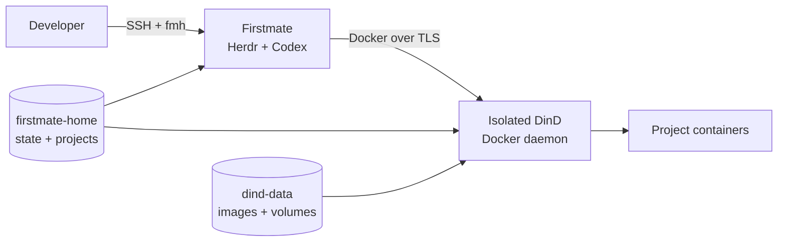

<p align="center">
  
</p>

<p align="center">
  Self-hosted development environment for <strong>Firstmate + Herdr + Codex CLI</strong>.
</p>

Firstmate Homelab keeps the agent runtime, Git worktrees, GitHub credentials and project Docker workloads on a homelab server. Agents get an isolated Docker-in-Docker environment instead of access to the physical host Docker socket.

> Herdr and Firstmate run on your infrastructure. Codex model inference still runs through OpenAI.

## Architecture



## Quick start

```bash
git clone https://github.com/sangimed/firstmate-homelab.git
cd firstmate-homelab
./scripts/install.sh

fmh login
fmh doctor
fmh connect
```

## Documentation

The full documentation is maintained with **MkDocs Material** under [`docs/`](docs/index.md) and is published at:

**https://sangimed.github.io/firstmate-homelab/**

Run it locally with:

```bash
python -m venv .venv
source .venv/bin/activate
pip install -r requirements-docs.txt
make docs-serve
```

Then open `http://127.0.0.1:8000`.

The documentation covers installation, daily CLI usage, Docker development, the developer shell, configuration, architecture, security and documentation deployment.

```bash
make docs-build   # validate/build the static site
make docs-serve   # local live-reload server
```

Documentation changes are validated on pull requests and deployed to GitHub Pages after they reach `main`.

## Upstream projects

- [Firstmate](https://github.com/kunchenguid/firstmate)
- [Herdr](https://herdr.dev/)
- [Treehouse](https://github.com/kunchenguid/treehouse)
- [Codex](https://developers.openai.com/codex/)
