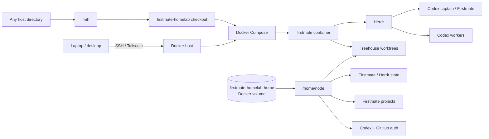

# firstmate-homelab

Self-hosted Docker stack for **Firstmate + Herdr + Codex CLI**.

The goal is to keep the agent runtime, Git worktrees, GitHub credentials and
Firstmate state on a homelab server while using Codex through a ChatGPT login.

> Herdr and Firstmate run on your infrastructure. Codex model inference still
> runs through OpenAI.

## Architecture



The repository checkout contains the Docker definition and host-side scripts.
Persistent runtime data lives separately in the Docker named volume. The global
`fmh` launcher remembers where the checkout lives, so you can operate the stack
from **any current directory**.

Your current working directory is deliberately **not** treated as a Firstmate
workspace.

Firstmate's Herdr backend is currently experimental upstream. Firstmate requires
Herdr protocol 14 or newer; Herdr 0.8.0+ is preferred for its default presentation
spaces behavior.

## Requirements

On the homelab host:

- Linux
- Docker Engine
- Docker Compose v2 (`docker compose`)
- outbound HTTPS access

Nothing else needs to be installed on the host.

## Quick start

```bash
git clone https://github.com/sangimed/firstmate-homelab.git
cd firstmate-homelab

./scripts/install.sh
```

The installer runs the normal setup and installs two host commands:

```text
fmh
firstmate-homelab
```

`fmh` is the recommended short form. After installation you no longer need to
run commands from inside the repository clone.

Authenticate and verify:

```bash
fmh login
fmh doctor
fmh connect
```

If `~/.local/bin` is not in your `PATH`, the installer prints the line to add to
your shell configuration.

### What installation does

`./scripts/install.sh`:

1. records the checkout path under `~/.config/firstmate-homelab/`;
2. installs the global launcher in `~/.local/bin`;
3. creates `.env` from `.env.example` if needed;
4. builds and starts the container;
5. installs/updates Herdr in the persistent agent home;
6. asks Firstmate's bootstrap which supported helper tools are missing;
7. installs the Herdr Codex integration.

Use this when you only want to install the launcher without provisioning the
stack yet:

```bash
./scripts/install.sh --skip-setup
```

Edit `.env` to set your Git commit identity:

```dotenv
GIT_USER_NAME=Your Name
GIT_USER_EMAIL=your-github-noreply@example.com
```

## Daily commands

The launcher always targets this installation's Compose project regardless of
your current directory.

```bash
fmh connect     # attach to the Herdr Firstmate session
fmh doctor      # verify the installation
fmh status      # show Compose status
fmh logs        # follow container logs
fmh shell       # open a shell in the container
fmh projects    # list Firstmate-managed projects
fmh paths       # show host/container persistence paths
fmh up          # start the stack
fmh down        # stop the stack
fmh update      # rebuild/update while preserving state
fmh help        # complete command reference
```

For example, all of these address the same Firstmate installation:

```bash
cd /tmp && fmh status
cd ~ && fmh doctor
cd ~/some-project && fmh connect
```

The caller's `pwd` has no special meaning.

## Authenticate

Run:

```bash
fmh login
```

For Codex on a headless server, the script uses:

```bash
codex login --device-auth
```

Open the displayed URL on your normal browser and enter the one-time code. This
uses your ChatGPT/Codex entitlement rather than an OpenAI API key.

The same command starts `gh auth login` and configures Git to use GitHub CLI
credentials. Authentication persists in the Docker named volume.

## Connect

```bash
fmh connect
```

This starts the stack when necessary and attaches to the named Herdr session
inside the container.

On the first empty Herdr pane, launch:

```bash
codex
```

Because the working directory is `/opt/firstmate`, Codex reads Firstmate's
`AGENTS.md` and becomes the Firstmate captain.

A useful first message is:

```text
Ahoy. Bootstrap this Firstmate installation.
Use Herdr as the runtime backend and Codex as the crew harness.
Check the toolchain and report any blocker before changing a project.
```

From that point, talk to the captain rather than manually starting workers.

## Where are my projects and data?

The persistent named volume defaults to:

```text
firstmate-homelab-home
```

It is mounted at `/home/node` inside the container and preserves:

- Codex authentication and sessions
- GitHub CLI authentication
- Herdr configuration/state
- Firstmate `config/`, `data/`, `state/` and `projects/`
- Treehouse worktrees/state
- helper tools installed in `~/.local`

Firstmate-managed project clones are available inside the container under:

```text
/home/node/.firstmate/projects
```

Do not guess the named-volume path on the host. Ask Docker:

```bash
fmh paths
```

Typical output includes the actual Docker mountpoint, the container home and the
Firstmate project directory. This works with Docker installations whose volume
root is not `/var/lib/docker` too.

Do **not** use `docker compose down -v` unless you intentionally want to delete
credentials, cloned projects, sessions and Firstmate state.

## Updating

```bash
fmh update
```

The image is rebuilt and the persistent toolchain is refreshed. The home volume
is kept.

For reproducibility, pin these in `.env`:

```dotenv
FIRSTMATE_REF=<firstmate commit/tag>
CODEX_VERSION=<codex npm version>
```

The defaults (`main` and `latest`) intentionally favor easy updates.

## Uninstalling

A normal uninstall is intentionally conservative:

```bash
fmh uninstall
```

It stops the Compose application and removes the global launcher/configuration,
but **keeps the persistent Docker volume** and **does not delete your repository
clone**.

To intentionally delete credentials, project clones and all persistent runtime
state as well:

```bash
fmh uninstall --purge
```

The purge requires typing `purge` explicitly. Automation can opt into destructive
removal with `fmh uninstall --purge --yes`.

See [docs/cli.md](docs/cli.md) for the complete lifecycle, reinstall behavior and
persistence model.

## Remote use

No port is exposed from the container.

A simple remote workflow is now:

```bash
ssh homelab
fmh connect
```

Using Tailscale for the SSH path avoids exposing an SSH port publicly.

## Security

The stack deliberately does **not** mount `/var/run/docker.sock`. Giving coding
agents access to the host Docker daemon is effectively giving them control over
the homelab host.

See [docs/security.md](docs/security.md) for the threat model,
[docs/architecture.md](docs/architecture.md) for the runtime design and
[docs/cli.md](docs/cli.md) for host-side operation and lifecycle.

## Upstream documentation

- Firstmate: https://github.com/kunchenguid/firstmate
- Firstmate Herdr backend: https://github.com/kunchenguid/firstmate/blob/main/docs/herdr-backend.md
- Herdr: https://herdr.dev/
- Herdr integrations: https://herdr.dev/docs/integrations/
- Treehouse: https://github.com/kunchenguid/treehouse
- Codex authentication: https://developers.openai.com/codex/auth
