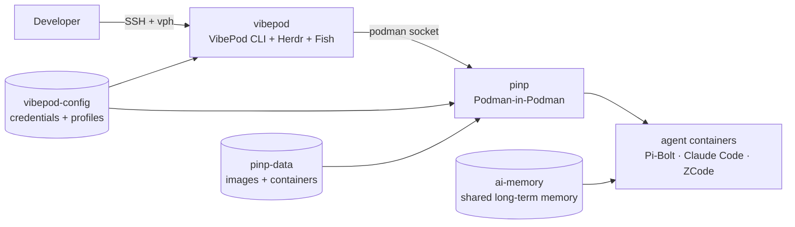

<p align="center">
  
</p>

<p align="center">
  Self-hosted <strong>VibePod</strong> agent platform with <strong>Pi-Bolt</strong>, <strong>Claude Code</strong> and <strong>ZCode</strong>, running in a rootless <strong>Podman-in-Podman</strong> (PinP) pod.
</p>

VibePod Homelab keeps the agent runner, credentials, memory and project workspaces on a homelab server. Agents run in containers managed by [VibePod](https://vibepod.dev), spawned into an isolated inner Podman — **PinP**, the Podman equivalent of Docker-in-Docker — instead of touching the host Docker/Podman socket.

> Everything runs **rootless** (Podman + systemd user units, pasta networking). No daemon, no Docker, no root.

## Architecture



- **`vibepod`** — the control plane: VibePod CLI (`vp`), Herdr (multiplexer), the Fish developer shell, the podman client, and the ai-memory CLI.
- **`pinp`** — Podman-in-Podman: the inner podman daemon VibePod targets. Agents (and any project containers they build) run here.
- **`ai-memory`** — a long-term memory server shared by every agent across sessions.

The important boundary is unchanged from the old DinD design: agents get a real container runtime, but **not the host's socket**.

## Quick start

```bash
git clone https://github.com/<you>/vibepod-homelab.git
cd vibepod-homelab
./scripts/install.sh   # deploy rootless quadlets + build control plane + PinP

vph setup              # build the Pi-Bolt image into PinP + wire ai-memory
vph login              # authenticate agents + GitHub CLI
vph doctor             # verify the stack
vph connect            # open a Herdr multiplexer session
```

Inside a Herdr pane, run an agent:

```bash
vp run pi        # Pi-Bolt (default)
vp run claude    # Claude Code
vp run zcode     # ZCode
```

## Images

| Image | File | Base | Purpose |
|-------|------|------|---------|
| control plane | `Containerfile` | `ghcr.io/gitguardian/wolfi/bun` | `vp` + Herdr + Fish + toolbox + podman client + ai-memory CLI |
| PinP | `docker/pinp/Containerfile` | `quay.io/podman/stable` | inner podman daemon (vfs storage) |
| Pi agent | `docker/pi/Containerfile` | `ghcr.io/gitguardian/wolfi/bun` | Pi-Bolt (aliased `pi`) + Claude Code + ZCode |
| ai-memory | `docker/ai-memory/Containerfile` | `chainguard/wolfi-base` | long-term memory server (upstream release binary + hooks) |

Wolfi is **glibc + apk** — small like Alpine but able to run native binaries (`pi-bolt`, Claude Code), which musl cannot.

## Documentation

Full documentation lives under [`docs/`](docs/index.md) (MkDocs Material). Key pages:

- [Architecture](docs/concepts/architecture.md) — pod topology, PinP, persistence, networking.
- [Security](docs/concepts/security.md) — trust boundary and PinP limitations.
- [Deployment](docs/reference/deployment.md) — rootless prerequisites, quadlets, subuid/subgid, pasta, ai-memory + VibePod board wiring.

Run locally:

```bash
python -m venv .venv && source .venv/bin/activate
pip install -r requirements-docs.txt
make docs-serve
```

## Upstream projects

- [VibePod](https://vibepod.dev) — one CLI for all AI coding agents, in containers.
- [Pi-Bolt](https://github.com/opensec-git/Pi-Bolt) — Pi, compiled ahead of time to native code.
- [Pi](https://github.com/earendil-works/pi) — the coding agent.
- [Herdr](https://herdr.dev) — terminal multiplexer for coding agents.
- [ai-memory](https://github.com/akitaonrails/ai-memory) — long-term memory for coding agents.
- [vibepod-board](https://github.com/VibePod/vibepod-board) — task board for agent automation.
