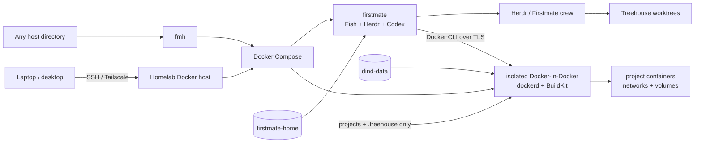

<p align="center">
  
</p>

<p align="center">
  Self-hosted development environment for <strong>Firstmate + Herdr + Codex CLI</strong>.
</p>

The goal is to keep the agent runtime, Git worktrees, GitHub credentials,
Firstmate state and project Docker workloads on a homelab server while using
Codex through a ChatGPT login.

> Herdr and Firstmate run on your infrastructure. Codex model inference still
> runs through OpenAI.

## Architecture



The physical host Docker socket is deliberately **not** mounted. Agents get a
real Docker CLI, but it targets a dedicated DinD daemon whose images, containers,
BuildKit cache and inner volumes are isolated from normal homelab Docker
workloads.

Firstmate and DinD share one network namespace, so a project that publishes
`3000:3000` is still reachable by agents at `http://localhost:3000`.

The global `fmh` launcher remembers where the checkout lives, so you can operate
the stack from **any current directory**. Your caller `pwd` is deliberately not
treated as a Firstmate workspace.

## Requirements

On the homelab host:

- Linux
- Docker Engine 26+
- Docker Compose v2 with `volume.subpath` support
- outbound HTTPS access

Nothing else needs to be installed on the host.

## Quick start

```bash
git clone https://github.com/sangimed/firstmate-homelab.git
cd firstmate-homelab

./scripts/install.sh
```

The installer runs the normal setup and installs two host commands:

```text
fmh
firstmate-homelab
```

`fmh` is the recommended short form. After installation you no longer need to
run commands from inside the repository clone.

Authenticate and verify:

```bash
fmh login
fmh doctor
fmh connect
```

If `~/.local/bin` is not in your `PATH`, the installer prints shell-specific
instructions for Fish, Zsh, Bash and other common shells.

### What installation does

`./scripts/install.sh`:

1. validates Docker/Compose support for the isolated workspace mounts;
2. records the checkout path under `~/.config/firstmate-homelab/`;
3. installs the global launcher in `~/.local/bin`;
4. creates `.env` from `.env.example` if needed;
5. starts the isolated DinD daemon and Firstmate container;
6. installs/updates Herdr in the persistent agent home;
7. asks Firstmate's bootstrap which supported helper tools are missing;
8. installs the Herdr Codex integration.

Use this when you only want to install the launcher without provisioning the
stack yet:

```bash
./scripts/install.sh --skip-setup
```

Edit `.env` to set your Git identity and optionally pin upstream versions:

```dotenv
GIT_USER_NAME=Your Name
GIT_USER_EMAIL=your-github-noreply@example.com

DOCKER_VERSION=29
FIRSTMATE_REF=main
CODEX_VERSION=latest
```

## Daily commands

```bash
fmh connect     # attach to the persistent Herdr session
fmh doctor      # verify Firstmate, DinD and bind mounts
fmh status      # show Firstmate / DinD / initializer status
fmh logs        # follow Firstmate and DinD logs
fmh shell       # open the Fish developer shell
fmh projects    # list Firstmate-managed projects
fmh paths       # show persistence and Docker paths
fmh up          # start the stack
fmh down        # stop the stack
fmh update      # update while preserving all persistent state
fmh help        # complete command reference
```

For example, all of these address the same Firstmate installation:

```bash
cd /tmp && fmh status
cd ~ && fmh doctor
cd ~/some-project && fmh connect
```

## Docker development

Inside `fmh shell`, a Herdr pane, or a Treehouse worktree, Docker behaves like a
normal development workstation:

```bash
docker version
docker build .
docker compose up --build
```

Those commands **do not** target the physical homelab Docker daemon.

Firstmate-managed projects and Treehouse worktrees are exposed to DinD at the
same absolute paths, so normal project-relative bind mounts work:

```yaml
services:
  api:
    volumes:
      - .:/app
```

The inner daemon persists its `/var/lib/docker` state in the dedicated
`firstmate-homelab-dind-data` volume, so warm image/build caches and project
Docker volumes survive `fmh update` and normal restarts.

See [docs/docker-in-docker.md](docs/docker-in-docker.md) for the detailed storage,
performance, networking and security model.

## Authenticate

Run:

```bash
fmh login
```

For Codex on a headless server, the script uses:

```bash
codex login --device-auth
```

Open the displayed URL on your normal browser and enter the one-time code. This
uses your ChatGPT/Codex entitlement rather than an OpenAI API key.

The same command starts `gh auth login` and configures Git to use GitHub CLI
credentials. Authentication persists in `firstmate-home`.

## Connect

```bash
fmh connect
```

This starts the stack when necessary and attaches to the named Herdr session.

On the first empty Herdr pane, launch:

```bash
codex
```

Because the working directory is `/opt/firstmate`, Codex reads Firstmate's
`AGENTS.md` and becomes the Firstmate captain.

A useful first message is:

```text
Ahoy. Bootstrap this Firstmate installation.
Use Herdr as the runtime backend and Codex as the crew harness.
Check the toolchain and report any blocker before changing a project.
```

### Leaving a session

For `fmh shell`, leave with `exit` or `Ctrl+D`.

For `fmh connect`, detach **without stopping panes or agents** with:

```text
Ctrl+B, then Q
```

Return later with:

```bash
fmh connect
```

Do not use `fmh down` merely to disconnect; it stops Firstmate and the isolated
Docker daemon.

## Where are my projects and data?

The persistent Firstmate home defaults to:

```text
firstmate-homelab-home
```

and preserves:

- Codex authentication and sessions;
- GitHub CLI authentication;
- Herdr configuration/state;
- Firstmate `config/`, `data/`, `state/` and `projects/`;
- Treehouse worktrees/state;
- helper tools installed in `~/.local`.

Firstmate-managed projects are available at:

```text
/home/node/.firstmate/projects
```

Treehouse worktrees live under:

```text
/home/node/.treehouse
```

Both paths are visible to DinD for project bind mounts. DinD does not receive
ordinary mounts for `.codex` or `.config/gh`.

The isolated Docker daemon persists separately in:

```text
firstmate-homelab-dind-data
```

Ask Docker for the real host mountpoints instead of guessing them:

```bash
fmh paths
```

## Updating

```bash
fmh update
```

This refreshes the DinD/runtime images, rebuilds Firstmate and updates persistent
user-space tooling. Authentication, projects, Treehouse worktrees, DinD images,
BuildKit cache and inner Docker volumes are kept.

## Uninstalling

A normal uninstall is intentionally conservative:

```bash
fmh uninstall
```

It removes the runtime containers and global launcher but **keeps all persistent
Firstmate and DinD volumes**. The repository clone is also kept.

To intentionally delete credentials, project clones, worktrees, project Docker
containers/volumes, images and build cache as well:

```bash
fmh uninstall --purge
```

The purge requires typing `purge` explicitly. Automation can opt into destructive
removal with `fmh uninstall --purge --yes`.

## Remote use

No Firstmate or project port is automatically exposed on the physical host.

A normal remote workflow is:

```bash
ssh homelab
fmh connect
```

Using Tailscale for the SSH path avoids exposing an SSH port publicly.

## Security

The stack never mounts the physical `/var/run/docker.sock`. Classic DinD does,
however, require a **privileged** sidecar, so it must not be treated as a hard
sandbox against the homelab Linux kernel. For a stronger boundary, run the entire
stack inside a dedicated VM.

See:

- [docs/security.md](docs/security.md) — threat model and privilege boundary;
- [docs/docker-in-docker.md](docs/docker-in-docker.md) — DinD architecture and performance;
- [docs/architecture.md](docs/architecture.md) — complete runtime design;
- [docs/developer-shell.md](docs/developer-shell.md) — Fish and terminal tooling;
- [docs/cli.md](docs/cli.md) — host-side operation and lifecycle.

## Upstream documentation

- Firstmate: https://github.com/kunchenguid/firstmate
- Firstmate Herdr backend: https://github.com/kunchenguid/firstmate/blob/main/docs/herdr-backend.md
- Herdr: https://herdr.dev/
- Herdr integrations: https://herdr.dev/docs/integrations/
- Treehouse: https://github.com/kunchenguid/treehouse
- Codex authentication: https://developers.openai.com/codex/auth
