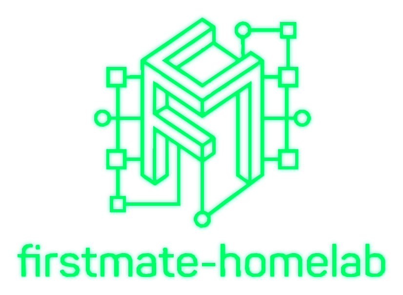
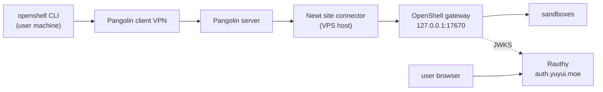

<p align="center">
  
</p>

<p align="center">
  Recipes for self-hosting AI coding agents with real isolation — starting with
  <strong>NVIDIA OpenShell</strong> behind <strong>Pangolin</strong>'s zero-trust VPN, with
  <strong>Rauthy</strong> as the OIDC identity provider.
</p>

Secure AI Homelab collects ways to run autonomous coding agents on your own
server without handing them your machine. The recommended path is a shared
**OpenShell** gateway reachable only over a private VPN, where each person gets
their own sandbox, agents are untrusted by default, and credentials never enter
the sandbox.

## Recommended: OpenShell over Pangolin



- **OpenShell** — kernel-enforced sandboxes (Landlock, seccomp) with
  deny-by-default network policy and gateway-held credentials.
- **Pangolin** — zero-trust connectivity. The gateway is a *private* resource,
  reachable only through the built-in VPN; nothing but the IdP is public.
- **Rauthy** — one lightweight OIDC provider for both Pangolin and OpenShell.
  One account, one login.

**Full recipe:** [OpenShell over Pangolin](docs/guides/openshell-pangolin.md).

Before you start, check the host can actually run OpenShell:

```bash
./scripts/check-openshell-host.sh --probe --container
```

## Layout

| Path | What it is |
|---|---|
| `docs/guides/openshell-pangolin.md` | The recommended recipe, end to end |
| `deploy/rauthy/` | Rauthy OIDC quadlets + env template |
| `deploy/ai-memory/` | ai-memory quadlets, env template, OpenShell provider profile |
| `scripts/check-openshell-host.sh` | OpenShell kernel preflight |
| `scripts/openshell-user-cert.sh` | Mint break-glass mTLS client certificates |
| `scripts/`, `systemd/`, `docker/`, `Containerfile` | The earlier VibePod Homelab stack |
| `docs/` | Documentation (MkDocs Material) |

## Previous approach: VibePod Homelab

The earlier stack runs **VibePod** agents in a rootless Podman-in-Podman pod with
a shared memory server. It is a single trust domain — appropriate for **one
trusted operator**, not for sharing with other people. It is kept here for
reference.

- [VibePod Homelab installation](docs/getting-started/installation.md)
- [Architecture](docs/concepts/architecture.md)
- [Security](docs/concepts/security.md)

## Documentation

Run the docs locally:

```bash
python -m venv .venv && source .venv/bin/activate
pip install -r requirements-docs.txt
make docs-serve
```

## Upstream projects

- [NVIDIA OpenShell](https://docs.nvidia.com/openshell/latest/) — safe runtime for autonomous agents.
- [Pangolin](https://pangolin.net) — open-source zero-trust networking platform.
- [Rauthy](https://sebadob.github.io/rauthy/) — lightweight OIDC identity provider.
- [VibePod](https://vibepod.dev) — one CLI for all AI coding agents, in containers.
- [ai-memory](https://github.com/akitaonrails/ai-memory) — long-term memory for coding agents.
