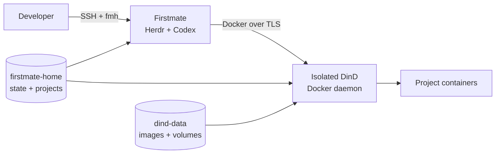

# Architecture

This repository packages the Firstmate + Herdr + Codex workflow together with an
isolated Docker-in-Docker daemon for project development.

## Runtime shape

Firstmate is an agent distro, not a network service. Herdr owns real terminal
processes, Firstmate launches workers into those terminals, and Treehouse provides
isolated Git worktrees.

The agent-facing tools remain in one long-lived `firstmate` container, while
project Docker workloads are delegated to a dedicated `docker:dind` service.



The physical host Docker Engine creates the outer Compose services, but the
physical host Docker socket is never mounted into Firstmate. Agents therefore do
not receive direct control over the normal homelab Docker daemon or its existing
workloads.

The `firstmate` service is the developer/agent environment. It contains the Docker
client only. The `docker:dind` service owns the Docker daemon, BuildKit and all
project Docker resources.

## Persistence boundary

`/opt/firstmate` belongs to the image and is deliberately disposable. Rebuilding
the image refreshes the upstream Firstmate checkout.

`firstmate-home` is mounted at `/home/node` and contains authentication caches,
Firstmate operational state, Herdr state, Treehouse data, cloned projects, and
user-space tools.

DinD receives only two `firstmate-home` subpaths at their original absolute
locations:

```text
/home/node/.firstmate/projects
/home/node/.treehouse
```

A one-shot `projects-init` service creates these directories before the DinD and
Firstmate services start. This is required because Docker Compose `volume.subpath`
expects the subdirectories to exist before mounting them.

Keeping the paths identical in Firstmate and DinD makes project and
Treehouse-worktree bind mounts resolve correctly when the Docker daemon lives in
another container. The ordinary Codex and GitHub credential paths are not mounted
into DinD.

The inner Docker engine has its own persistent `dind-data` volume at
`/var/lib/docker`, preserving image layers, BuildKit cache, project containers,
and inner named volumes independently from Firstmate state.

The official DinD TLS material is persisted separately in `dind-certs-ca` and
`dind-certs-client`. Firstmate receives only the client certificate volume and
mounts it read-only.

A container restart still terminates Linux processes. Herdr can restore compatible
agent sessions from persisted state, but a restart is not equivalent to detaching
from a live Herdr session.

## Docker networking

`firstmate` uses:

```yaml
network_mode: "service:docker"
```

so it shares the DinD network namespace. This deliberately preserves normal
workstation semantics for project-published ports. If an inner Compose project
publishes `3000:3000`, agents can reach it from Firstmate at:

```text
http://localhost:3000
```

Those inner ports are not automatically published on the physical homelab host.

The Docker API itself uses the official DinD TLS mechanism and is addressed by
Firstmate as `tcp://localhost:2376` using generated client certificates. No Docker
API port is published on the physical host.

## Runtime selection

The stack sets both:

- `FM_BACKEND=herdr`
- `FM_HOME/config/backend` to `herdr`

and writes `codex` to `FM_HOME/config/crew-harness`.

The environment variable is explicit for the current process; the config files
also make the operational home self-describing.

## Remote administration

No Firstmate, DinD API or project port is published on the host by default. Codex,
GitHub CLI, installers, DinD image pulls, and project tooling use normal outbound
network access.

For remote administration, SSH to the Docker host (optionally over Tailscale) and
run:

```bash
fmh connect
```

## Docker workloads launched by agents

Agents can run normal Docker development commands inside Firstmate:

```bash
docker build .
docker compose up --build
docker run --rm ...
```

These commands target the isolated DinD daemon, not the homelab Docker daemon.
Project bind mounts are supported from Firstmate-managed project clones and
Treehouse worktrees because those paths are explicitly shared with DinD.

`fmh doctor` validates both Docker API connectivity and real bind-mount visibility
for the Firstmate projects and Treehouse roots, catching the common case where a
remote Docker daemon can be reached but cannot resolve the caller's filesystem.

See [docker-in-docker.md](docker-in-docker.md) for storage, performance, security,
and bind-mount details.
