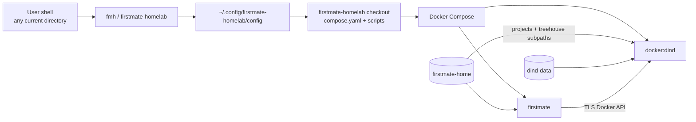

# Global launcher and lifecycle

`firstmate-homelab` ships a small host-side launcher so the stack can be operated
from any directory without having to `cd` back into the repository clone.

The short command is `fmh`. A longer `firstmate-homelab` alias is installed too.

## Install

From the repository clone:

```bash
./scripts/install.sh
```

This:

1. validates Docker/Compose support for the DinD workspace mounts;
2. records the absolute path of this checkout in
   `~/.config/firstmate-homelab/config` (or `$XDG_CONFIG_HOME` when set);
3. installs `~/.local/bin/fmh`;
4. installs `~/.local/bin/firstmate-homelab` as an alias;
5. runs the normal stack setup.

Use `./scripts/install.sh --skip-setup` to install only the launcher.

The launcher does **not** use your current working directory as a project or
workspace. It always addresses the `compose.yaml` belonging to the configured
Firstmate Homelab checkout.

## Commands

```text
fmh setup
fmh login
fmh doctor
fmh connect
fmh update
fmh up
fmh down
fmh status
fmh logs
fmh shell
fmh projects
fmh paths
fmh uninstall
fmh uninstall --purge
```

The most useful inspection commands are:

```bash
fmh status
fmh projects
fmh paths
fmh shell
```

`fmh status` includes the agent container, the isolated `docker:dind` daemon and
the one-shot project-volume initializer.

`fmh logs` follows both Firstmate and DinD logs.

`fmh paths` reports the persistent Firstmate home volume, the dedicated DinD data
volume, and their actual host mountpoints. Do not assume Docker stores volumes
under `/var/lib/docker`; rootless and alternative Docker setups may differ.

## Docker from Firstmate

Docker commands inside `fmh shell`, Herdr panes and Treehouse worktrees target the
isolated DinD daemon:

```bash
docker version
docker compose up --build
```

They do not target the physical homelab Docker socket.

Project-published ports are available from Firstmate at `localhost`, because the
agent and DinD services share one network namespace.

See [docker-in-docker.md](docker-in-docker.md) for the full model.

## Persistence

The stack deliberately separates the repository checkout from persistent runtime
data.



The Firstmate home contains authentication, agent state, project clones and
Treehouse worktrees. The DinD data volume separately contains images, BuildKit
cache, project containers and the inner Docker named volumes created by project
Compose files.

Removing the repository checkout does not delete either persistent volume.

## Leaving interactive sessions

For an ordinary shell opened with:

```bash
fmh shell
```

leave with `exit` or `Ctrl+D`.

For a persistent Herdr session opened with:

```bash
fmh connect
```

detach without stopping agents with:

```text
Ctrl+B, then Q
```

Return later with `fmh connect`.

## Uninstall

### Safe uninstall

```bash
fmh uninstall
```

This stops the Compose application, removes the global launchers and launcher
configuration, and **keeps all persistent volumes**. Authentication, project
clones, Firstmate/Herdr state, Treehouse worktrees, DinD images, BuildKit cache,
project containers and inner Docker volumes therefore survive.

The repository clone is also kept. It may contain local modifications and is
never deleted automatically.

### Full purge

```bash
fmh uninstall --purge
```

This performs the normal uninstall and deletes:

- `firstmate-home`;
- the DinD `/var/lib/docker` volume;
- the DinD TLS certificate volumes.

That destroys credentials, source clones, worktrees, nested project databases,
images and build cache, so the command requires typing `purge` explicitly.

For automation only, the confirmation can be bypassed with:

```bash
fmh uninstall --purge --yes
```

Use this only when destructive removal is intentional.

## Reinstall

If a safe uninstall kept the volumes, reinstall from the same or a fresh checkout:

```bash
./scripts/install.sh
fmh doctor
```

As long as the configured volume names are unchanged, Docker reattaches the
persistent Firstmate and DinD state when the stack starts.
