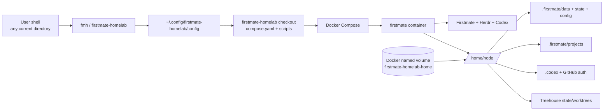

# Global launcher and lifecycle

`firstmate-homelab` ships a small host-side launcher so the stack can be operated
from any directory without having to `cd` back into the repository clone.

The short command is `fmh`. A longer `firstmate-homelab` alias is installed too.

## Install

From the repository clone:

```bash
./scripts/install.sh
```

This:

1. records the absolute path of this checkout in
   `~/.config/firstmate-homelab/config` (or `$XDG_CONFIG_HOME` when set);
2. installs `~/.local/bin/fmh`;
3. installs `~/.local/bin/firstmate-homelab` as an alias;
4. runs the normal stack setup.

Use `./scripts/install.sh --skip-setup` to install only the launcher.

The launcher does **not** use your current working directory as a project or
workspace. It always addresses the `compose.yaml` belonging to the configured
Firstmate Homelab checkout.

## Commands

```text
fmh setup
fmh login
fmh doctor
fmh connect
fmh update
fmh up
fmh down
fmh status
fmh logs
fmh shell
fmh projects
fmh paths
fmh uninstall
fmh uninstall --purge
```

The most useful inspection commands are:

```bash
fmh status
fmh projects
fmh paths
fmh shell
```

`fmh paths` reports both the container paths and the actual Docker volume
mountpoint on the host. Do not assume that Docker stores volumes under
`/var/lib/docker`; rootless and alternative Docker setups may use another path.

## Persistence

The stack deliberately separates the repository checkout from persistent runtime
data.



Removing the repository checkout is not the same thing as deleting the Docker
volume. Conversely, deleting the Docker volume destroys persistent Firstmate
data even if the checkout still exists.

## Uninstall

### Safe uninstall

```bash
fmh uninstall
```

This stops the Compose application, removes the global launchers and launcher
configuration, and **keeps** the named Docker volume. Authentication, project
clones, Firstmate state, Herdr state and Treehouse data therefore survive.

The repository clone is also kept. It may contain local modifications and is
never deleted automatically.

### Full purge

```bash
fmh uninstall --purge
```

This performs the normal uninstall and also deletes the persistent Docker volume.
Because that destroys credentials, project clones and runtime state, the command
requires typing `purge` explicitly.

For automation only, the confirmation can be bypassed with:

```bash
fmh uninstall --purge --yes
```

Use this only when destructive removal is intentional.

## Reinstall

If a safe uninstall kept the Docker volume, reinstall from the same or a fresh
checkout:

```bash
./scripts/install.sh
fmh doctor
```

As long as the configured volume name is unchanged, Docker reattaches the
persistent data when the stack starts.
