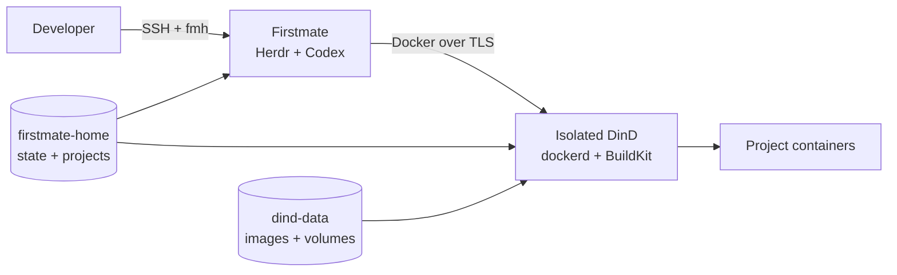

# Architecture

Firstmate Homelab packages the Firstmate + Herdr + Codex workflow together with an isolated Docker-in-Docker runtime for project development.

## Runtime model



The `firstmate` service is the long-lived developer and agent environment. It contains Fish, Herdr, Codex, GitHub CLI, Treehouse and the Docker client.

The `docker:dind` service owns the actual Docker daemon, BuildKit and all project Docker resources.

The physical homelab Docker Engine only runs the outer Compose stack. Its `/var/run/docker.sock` is never mounted into Firstmate.

## Persistence boundary

`/opt/firstmate` belongs to the image and is disposable. Rebuilding the image refreshes the upstream Firstmate checkout.

The `firstmate-home` volume is mounted at `/home/node` and preserves:

- Codex authentication and sessions;
- GitHub CLI authentication;
- Firstmate and Herdr state;
- project clones;
- Treehouse worktrees;
- user-space tools installed under `~/.local`.

The isolated Docker daemon has its own `dind-data` volume mounted at `/var/lib/docker`, preserving images, BuildKit cache, project containers and inner Docker named volumes independently from Firstmate state.

## Shared project paths

A remote Docker daemon resolves bind mounts in the daemon filesystem, not the Docker CLI filesystem.

DinD therefore receives only these two code-bearing subpaths from `firstmate-home`, at the same absolute locations used inside Firstmate:

```text
/home/node/.firstmate/projects
/home/node/.treehouse
```

A small one-shot `projects-init` service creates those directories before Firstmate and DinD start because Docker Compose `volume.subpath` expects the subdirectories to exist.

Codex and GitHub credential paths are not mounted into DinD as normal workspace mounts.

## Networking

Firstmate uses:

```yaml
network_mode: "service:docker"
```

so it shares the DinD network namespace.

This preserves workstation-like behavior for project ports. If an inner project publishes `3000:3000`, agents can reach it from Firstmate at:

```text
http://localhost:3000
```

That port is not automatically published on the physical homelab host.

The Docker client itself connects to the DinD API over TLS at:

```text
tcp://localhost:2376
```

The API is not exposed as a physical host port.

## Runtime selection

The stack explicitly selects Herdr as the Firstmate backend and Codex as the crew harness. The configuration is persisted under the Firstmate home so the operational state remains self-describing across rebuilds.

## Lifecycle

A container restart terminates Linux processes. Persistent state allows compatible sessions to be restored, but restarting the container is not equivalent to detaching from a live Herdr session.

Use `fmh connect` to reattach to a live session and `Ctrl+B`, then `Q` to detach without stopping it.

For Docker-specific usage, see [Docker development](../guides/docker-development.md). For the privilege boundary, see [Security](security.md).
