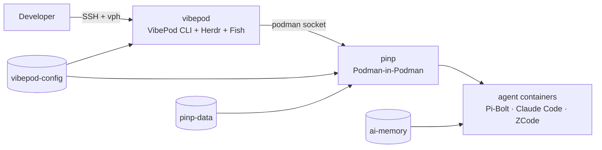

# Architecture

!!! note "Previous approach"
    This page documents the earlier VibePod Homelab stack. The recommended path is [OpenShell over Pangolin](../guides/openshell-pangolin.md).

VibePod Homelab packages the VibePod agent runner together with an isolated Podman-in-Podman (PinP) runtime for agent and project containers.

## Runtime model

Three containers share one rootless pod (one network namespace):

1. **`vibepod`** — the long-lived control plane. It contains the VibePod CLI (`vp`), Herdr (terminal multiplexer), the Fish developer shell, the podman client, and the ai-memory CLI. It is *not* where agents execute.
2. **`pinp`** — the inner Podman daemon. `vp run <agent>` talks to it over a shared unix socket and spawns agent containers inside it. This is the Podman equivalent of the old Docker-in-Docker sidecar.
3. **`ai-memory`** — a long-term memory server (HTTP MCP at `/mcp`, lifecycle `/hook`, web UI) shared by every agent. Built locally from the upstream release binary on a Debian base (`docker/ai-memory/Containerfile`).

Everything runs **rootless**: the pod is a set of Podman **quadlets** (systemd user units), with **pasta** providing rootless networking.

## Runtime selection

VibePod replaces Codex as the agent runner. There is no `DOCKER_HOST`:

- VibePod auto-detects Podman when `DOCKER_HOST` is unset;
- the PinP socket is mounted at podman's default path (`/run/podman/podman.sock`) in the control plane;
- `CONTAINER_HOST` is set only as a belt-and-suspenders hint.

The default agent is `pi`, whose image is the standard Pi coding agent (`vibepod/pi:latest`) — built directly into PinP, so no registry is involved. Claude Code and ZCode are additional harnesses in the same agent set.

## The Pi agent image

`docker/pi/Containerfile` descends from VibePod's own `pi` agent, upgraded:

| | Before (VibePod `pi`) | Here |
|---|---|---|
| base | `node:22-slim` | `node:22-slim` (Debian, glibc baseline) |
| agent | `@earendil-works/pi-coding-agent` | standard Pi (pure JS on Node) |
| `pi` command | bundled | `pi` (npm bin) |
| `~/.pi` mount | kept | kept (Pi reads `~/.pi/agent`) |
| extra harnesses | — | Claude Code (`2.1.112`) + ZCode |
| ai-memory | — | bridge extension baked in (`ai-memory install-hooks --agent pi`) |

The image is **Debian + Node, not Wolfi and not pi-bolt**, so it runs on hosts
whose CPU lacks SSE4.2 (x86-64 baseline): there Wolfi's glibc dies with `Fatal
glibc error: CPU does not support x86-64-v2`, and pi-bolt exits with *"Pi-Bolt
needs a CPU with SSE4.2"*. Claude Code is pinned to `2.1.112` because 2.1.113+ is
a native binary that spins at 100% CPU on such hosts; Bun's global installer
hangs there too, so the image uses `npm`. It ends with `USER 1000:1000` because
OpenShell rejects a root workload identity.

The agent's `HOME` is `/config` (the persisted VibePod agent config dir), so `~/.pi/agent`, `~/.claude` and `~/.zcode` all survive container replacement.

## The ai-memory image

Upstream publishes `akitaonrails/ai-memory` with a Debian runtime stage. Homelab vendors that build as `docker/ai-memory/Containerfile`:

| | Upstream | Here |
|---|---|---|
| runtime base | `debian:bookworm-slim` | `debian:bookworm-slim` (glibc baseline) |
| binary | compiled in-image (Rust builder) | pinned upstream release tarball (`AI_MEMORY_VERSION=2.6.3`) |
| service user | `ai-memory` uid 1000 | `ai-memory` uid 1000 |
| source | Docker Hub pull | built locally (fully self-hosted) |

The release binary is glibc-linked and needs only glibc/libgcc/zlib — all present in the Debian base — plus CA certificates for outgoing HTTPS to LLM providers. The Debian base (not Wolfi) is what lets it run on CPUs without x86-64-v2.

## Persistence boundary

| Volume | Mounted in | Holds |
|---|---|---|
| `vibepod-config` | `vibepod` + `pinp` (same path) | VibePod config, agent credentials, profiles, session logs, proxy DB |
| `workspaces` | `vibepod` + `pinp` (same path) | project source |
| `pinp-data` | `pinp` | inner Podman images, containers, build cache |
| `pinp-socket` | `pinp` (rw) + `vibepod` (ro) | the inner podman unix socket |
| `ai-memory-data` | `ai-memory` | the memory wiki + index |

`vibepod-config` and `workspaces` are mounted at **the same absolute path** in both the control plane and PinP. A remote container runtime resolves bind-mount sources in its own filesystem, so when VibePod mounts `/home/developer/.config/vibepod/agents/pi` (or a workspace) into an agent, the inner Podman must see that path — exactly the shared-path requirement the old DinD design had for `.firstmate/projects` and `.treehouse`.

## Networking

The pod shares one network namespace:

- `vibepod` and `pinp` reach `ai-memory` at `localhost:49374`;
- agents spawned in PinP reach the pod (and thus ai-memory) through the pasta gateway alias `host.containers.internal:49374`;
- project ports published by agents are reachable from the control plane at `localhost`, but are **not** automatically published on the host.

## Lifecycle

A pod restart terminates running agent containers. Persistent state (credentials, memory, workspaces, PinP storage) survives.

- `vph connect` opens a Herdr session; `Ctrl+B` then `Q` detaches without stopping it.
- `vph down` / `vph up` stop / start the whole pod via systemd.

For the PinP development workflow see [PinP development](../guides/pinp-development.md); for the privilege boundary see [Security](security.md).
