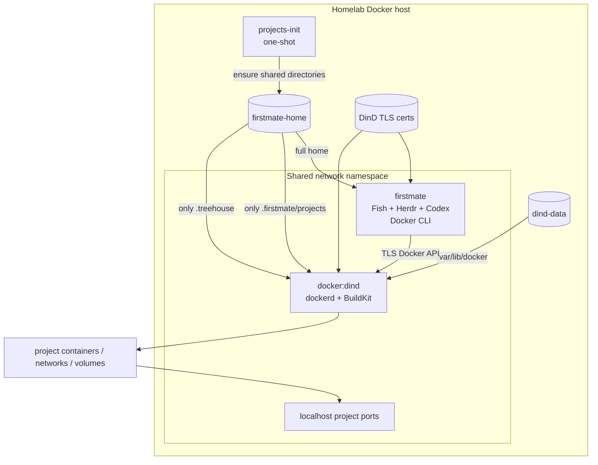

# Isolated Docker-in-Docker runtime

Firstmate Homelab gives agents a real Docker development environment without
mounting the homelab host Docker socket.

## Architecture



The host `/var/run/docker.sock` is never mounted.

The `firstmate` container contains only the Docker client. `dockerd`, BuildKit,
project images, project containers, project networks and inner Docker volumes all
belong to the dedicated `docker:dind` service.

## Why the same network namespace?

Firstmate and DinD share one network namespace with:

```yaml
network_mode: "service:docker"
```

This is deliberate. A project can publish a port normally:

```yaml
services:
  web:
    ports:
      - "3000:3000"
```

and agent processes can still test it with the workstation-like address:

```bash
curl http://localhost:3000
```

The port is published inside the shared Firstmate/DinD namespace, not directly on
the physical homelab host.

## Filesystem visibility and bind mounts

A remote Docker daemon resolves bind-mount source paths in the daemon filesystem,
not in the Docker CLI container. Firstmate therefore exposes its two code-bearing
areas to DinD at the exact same absolute paths:

```text
/home/node/.firstmate/projects
/home/node/.treehouse
```

Only these subdirectories of `firstmate-home` are mounted into DinD. In
particular, DinD does not receive normal volume mounts for:

```text
/home/node/.codex
/home/node/.config/gh
```

That preserves existing project data without copying it to a new volume while
keeping the Docker daemon away from the normal Codex/GitHub credential paths.

A tiny `projects-init` service ensures the required subdirectories exist before
Docker starts. Existing projects remain in place.

### Supported bind-mount scope

Project Compose files using relative mounts work as expected when they are run
from a Firstmate project or Treehouse worktree, for example:

```yaml
volumes:
  - .:/app
```

Arbitrary bind mounts from unrelated Firstmate paths are not guaranteed. If a
project needs a host-side bind mount, keep that source within its project/worktree
or redesign it as an inner Docker named volume.

## Docker storage

The inner daemon stores all Docker state in a dedicated named volume:

```text
firstmate-homelab-dind-data
```

mounted at:

```text
/var/lib/docker
```

This avoids putting Docker's `overlay2` data inside the writable layer of the
outer DinD container and preserves the expensive state across rebuilds:

- image layers;
- BuildKit cache;
- project containers;
- project networks;
- inner Docker named volumes (for example PostgreSQL data).

`fmh update` keeps this volume.

## TLS

The Docker API uses the TLS support built into the official DinD image.

Firstmate connects to:

```text
tcp://localhost:2376
```

with the generated client certificates mounted read-only into the agent
container. The API is not published as a host port.

## Performance expectations

DinD does not create another virtual machine. Inner containers still execute on
the homelab Linux kernel, so CPU overhead is normally small.

The main performance-sensitive areas are:

1. Docker storage and copy-on-write behavior;
2. build context size;
3. nested networking;
4. filesystem-heavy dependency trees.

The dedicated `/var/lib/docker` volume is therefore important. Projects should
also use a good `.dockerignore`, especially for Node/TypeScript repositories:

```dockerignore
.git
node_modules
.next
dist
coverage
```

Warm builds benefit from the persistent BuildKit/image cache in `dind-data`.

## Security boundary

The design deliberately improves one important property over Docker-outside-of-
Docker: an agent never receives the physical host Docker socket.

However, classic DinD still requires:

```yaml
privileged: true
```

The DinD service must therefore not be treated as a strong sandbox against the
homelab kernel. The security goal here is narrower:

- do not hand agents the existing homelab Docker daemon;
- isolate agent-created containers/images/volumes from normal homelab workloads;
- avoid mounting ordinary host directories;
- scope normal persistent-home visibility to project/worktree directories.

For a stronger host boundary, run Firstmate Homelab itself inside a dedicated VM.

## Using Docker

After installation or update:

```bash
fmh doctor
fmh shell
```

Inside Firstmate:

```bash
docker version
docker info
docker compose version
```

Then use Docker exactly as you would on a development workstation:

```bash
cd ~/.firstmate/projects/my-project
docker compose up --build
```

Treehouse worktrees can do the same because `~/.treehouse` is shared with DinD.

## Diagnostics

`fmh doctor` verifies more than API connectivity. It creates temporary markers in
both shared workspace roots and asks an inner BusyBox container to bind-mount and
read them. This catches the common DinD failure mode where `docker` works but
project bind mounts resolve in the wrong filesystem.

`fmh status` shows Firstmate, DinD and the one-shot initializer.

`fmh logs` follows both Firstmate and DinD logs.

`fmh paths` shows the persistent home and DinD storage volumes.

## Lifecycle

A normal stop or uninstall preserves both agent state and nested Docker state:

```bash
fmh down
fmh uninstall
```

A full purge deletes:

- `firstmate-home`;
- DinD `/var/lib/docker` data;
- DinD TLS certificate volumes.

```bash
fmh uninstall --purge
```

The destructive purge still requires the explicit `purge` confirmation unless
`--yes` is supplied.
