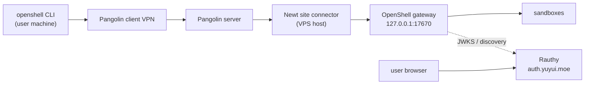

# OpenShell over Pangolin (private VPN)

Run a shared NVIDIA **OpenShell** gateway on a Debian VPS, reachable only through
**Pangolin**'s zero-trust VPN, with **Rauthy** as the OIDC identity provider. One
Rauthy account signs you into both Pangolin and OpenShell.

This is the primary recipe for Secure AI Homelab. The [VibePod Homelab](#previous-approach-vibepod-homelab)
pages describe the earlier single-host approach.

## What this gives you

- Each person runs `openshell` on their own machine and reaches the gateway over
  the Pangolin VPN. Nothing is published on the public internet except the IdP.
- The gateway authenticates users with **OIDC** (Rauthy) and keeps **mTLS** as a
  break-glass path if the IdP is down.
- Agents run in OpenShell sandboxes: deny-by-default network, Landlock
  filesystem policy, and credentials held by the gateway, never in the sandbox.

## Topology



Two authentication layers protect the gateway:

| Layer | Question it answers | Where it is set |
|---|---|---|
| Pangolin private resource | Which user or device may open a tunnel | Pangolin roles/users |
| OpenShell OIDC / mTLS | Which identity may drive the gateway | Rauthy + gateway |

The gateway holds your Podman socket, so gateway access is equivalent to running
containers as your VPS user. Keep it private.

## Placeholders

Replace these throughout:

| Placeholder | Value used here | Meaning |
|---|---|---|
| `<alias>` | `ai-sbx.yuyui.moe` | Pangolin alias for the gateway |
| `<idp>` | `auth.yuyui.moe` | Public hostname of Rauthy |
| `<vps>` | your Debian VPS | Host running Newt + the gateway |

## Prerequisites

- Debian 13 (trixie) VPS, rootless Podman, and the OpenShell package installed:

  ```bash
  openshell --version
  openshell gateway list
  systemctl --user status openshell-gateway
  ```

- The kernel preflight passes. From this repo:

  ```bash
  ./scripts/check-openshell-host.sh --probe --container
  ```

- Pangolin with a **host-level Newt** site connector (`systemctl status newt`),
  and DNS for `<idp>` and `<alias>` under your domain.
- Your gateway is the loopback package install (`https://127.0.0.1:17670`). The
  paths below match Debian/RPM installs.

!!! warning "Set the SAN first"
    Adding a Subject Alternative Name changes the gateway's required SAN set, and
    `openshell-gateway` **regenerates the whole local PKI** (new CA, new server and
    client certificates) when that happens. Existing mTLS bundles stop working.
    Do [Part 2](#part-2-gateway-oidc-and-san) once, before you hand out any
    client certificates.

## Part 1 — Rauthy identity provider

Rauthy is a single ~40 MB Rust container with an embedded database. It must be
**publicly reachable over HTTPS** so the gateway can fetch its discovery document
and JWKS, and so each user's browser can reach the login page. The OpenShell
gateway itself stays private.

### 1.1 Secrets

`scripts/install-rauthy.sh` generates the encryption key, the active key id and
the two Hiqlite secrets when it writes the env file. To do it by hand:

```bash
key_id=$(openssl rand -hex 4); key=$(openssl rand -base64 32)
printf 'ENC_KEYS=%s/%s\nENC_KEY_ACTIVE=%s\n' "$key_id" "$key" "$key_id"
printf 'HQL_SECRET_RAFT=%s\n' "$(openssl rand -base64 48)"
printf 'HQL_SECRET_API=%s\n'  "$(openssl rand -base64 48)"
```

Rauthy refuses to start without **both** `ENC_KEYS` and `ENC_KEY_ACTIVE`.

### 1.2 Deploy Rauthy (quadlets)

Rauthy runs as a rootless Podman quadlet, like the rest of this repo — no compose.
On the VPS checkout:

```bash
./scripts/install-rauthy.sh auth.yuyui.moe    # copies quadlets, generates secrets
$EDITOR ~/.config/secure-ai-homelab/rauthy.env   # set BOOTSTRAP_ADMIN_EMAIL
systemctl --user start rauthy.service
podman logs -f rauthy        # copy the generated admin password (shown once)
```

Passing the domain fills `PUB_URL`, `RP_ID` and `RP_ORIGIN`. Three values are
easy to get wrong:

- `PUB_URL` is the authority **only** — `auth.yuyui.moe`, never `https://auth.yuyui.moe`.
  Rauthy derives the scheme from `LISTEN_SCHEME` + `PROXY_MODE` (and with
  `PROXY_MODE=true` it builds `https`).
- `RP_ID` is the bare domain (`auth.yuyui.moe`) and `RP_ORIGIN` **must include a port**
  (`https://auth.yuyui.moe:443`). Rauthy refuses to start without them.
- `ENC_KEYS` and `ENC_KEY_ACTIVE` are both required; the installer generates both.

!!! note "Quadlets cannot be enabled"
    Do not run `systemctl --user enable rauthy.service`. The unit is generated
    under `/run/user/<uid>/systemd/generator/`, and systemd rejects enabling a
    generated unit. The quadlet's `[Install] WantedBy=default.target` makes the
    generator enable it at `daemon-reload`, so `start` is all you need.

The unit (`deploy/rauthy/rauthy.container`) runs Rauthy on plain HTTP port `8080`,
bound to loopback, with `proxy_mode = true`. Rauthy's own TLS stays off because
Pangolin terminates TLS at `https://<idp>`. The embedded database and generated
signing keys live in the `rauthy-data` volume.

### 1.3 Expose Rauthy through Pangolin

Add a **public HTTP resource** for `<idp>` targeting `localhost:8080` on the Newt
site. Do **not** attach a Pangolin SSO policy to it — Rauthy is the identity
provider; a login gate in front of it creates a redirect loop.

Verify from anywhere (note the `/auth/v1/` path — Rauthy scopes its issuer to it):

```bash
curl -s https://<idp>/auth/v1/.well-known/openid-configuration | head
```

Rauthy's endpoints, which you need below:

| Value | URL |
|---|---|
| Issuer | `https://<idp>/auth/v1/` |
| Authorization | `https://<idp>/auth/v1/oidc/authorize` |
| Token | `https://<idp>/auth/v1/oidc/token` |
| JWKS | `https://<idp>/auth/v1/oidc/certs` |

### 1.4 Create the roles, groups and users

In the Rauthy admin UI (`https://<idp>/admin`):

1. **Roles** — create `openshell-admin` (you) and `openshell-user` (everyone
   else). These land in the access token's `roles` claim, which OpenShell reads.
2. **Add your user** and assign `rauthy_admin` **and** `openshell-admin`. Do not
   reuse the default `admin@localhost` account.
3. Add each other person and assign `openshell-user`.
4. Optionally create a group (for example `openshell`) so the OIDC client can be
   restricted to it.

### 1.5 Create the OpenShell OIDC client

Still in the admin UI, under **Clients**, create a client:

| Field | Value |
|---|---|
| Client id | `openshell-cli` |
| Confidential | No (public client, PKCE) |
| Redirect URIs | `http://127.0.0.1/callback` |
| Scopes | `openid profile email roles` |

!!! note "Why there is no port"
    The OpenShell CLI binds an **ephemeral** loopback port on every login
    (`TcpListener::bind("127.0.0.1:0")`), so the redirect is
    `http://127.0.0.1:<random>/callback`. Register the **port-less** form and keep
    `RFC_8252_ENABLE=true` in `rauthy.env` (the installer sets it): Rauthy then
    matches a loopback redirect on any port (RFC 8252 §7.3).

    Do **not** use `http://127.0.0.1:*/callback` — Rauthy parses the redirect as a
    real URL and rejects the `*` with "Invalid URI". I verified both directions on
    Rauthy 0.37.1: `RFC_8252_ENABLE=true` accepts an ephemeral port, and `false`
    returns `400 Invalid redirect uri`.

The client id `openshell-cli` is deliberate: Rauthy sets the access token
audience to the client id, which matches OpenShell's default audience.

### 1.6 Sign in to Pangolin with Rauthy (optional)

Pangolin can use the same Rauthy instance as its identity provider. **Pangolin
generates the redirect URL**, so the order matters:

1. In Rauthy, create a client for Pangolin (confidential). Leave the redirect URI
   empty if Rauthy lets you; otherwise put a temporary placeholder and fix it in
   step 4. Note the client id and secret.
2. In Pangolin, add an **OAuth2/OIDC** identity provider with the fields below.
3. Create it, open the provider's **General** tab, and copy its **Redirect URL**.
4. Put that Redirect URL into the Rauthy client's `redirect_uris` and save.

| Pangolin field | Value |
|---|---|
| Client ID / Secret | from the Rauthy client |
| Authorization URL | `https://<idp>/auth/v1/oidc/authorize` |
| Token URL | `https://<idp>/auth/v1/oidc/token` |
| Identifier path | `sub` |
| Email path | `email` |
| Name path | `preferred_username` |
| Scopes | `openid profile email` |

**Post Logout Redirect:** Pangolin's documentation defines only the Redirect URL;
it does not document a post-logout URL for the OIDC provider. Rauthy's `Post
Logout Redirect URIs` field is optional, so leave it empty unless your provider's
General tab shows a logout URL to use.

Reference (Pangolin):

- [OAuth2/OIDC identity provider](https://docs.pangolin.net/manage/identity-providers/openid-connect)
- [Add Identity Providers](https://docs.pangolin.net/manage/identity-providers/add-an-idp)
- [Zitadel example](https://docs.pangolin.net/manage/identity-providers/zitadel) —
  documents the "copy the Redirect URL from the General tab" step

## Part 2 — Gateway OIDC and SAN

On the VPS, edit `~/.config/openshell/gateway.toml`.

### 2.1 Add the alias SAN

```toml
[openshell.gateway]
# Keep the package default listener and driver
server_sans = ["<alias>", "openshell", "*.dev.openshell.localhost", "127.0.0.1", "localhost"]

[openshell.gateway.oidc]
issuer           = "https://<idp>/auth/v1/"
audience         = "openshell-cli"
roles_claim      = "roles"
admin_role       = "openshell-admin"
user_role        = "openshell-user"
scopes_claim     = ""
# jwks_allowed_origins defaults to the issuer origin; leave it unset unless the
# IdP serves JWKS from another origin.
```

### 2.2 Keep mTLS as break-glass

With an OIDC issuer configured, mTLS user authentication defaults **off**. Force
it back on so your client certificate still works when Rauthy is down. Write
`~/.config/openshell/gateway.env`:

```bash
OPENSHELL_ENABLE_MTLS_AUTH=true
```

The Debian/RPM package loads this file for gateway startup. The local client CA
under `~/.local/state/openshell/tls/ca.crt` is used automatically.

### 2.3 Restart and verify

```bash
systemctl --user restart openshell-gateway
journalctl --user -u openshell-gateway -n 50 --no-pager
openshell gateway list
openshell status
```

Because the SAN set changed, `~/.local/state/openshell/tls/` is regenerated. Any
machine that already had the old mTLS bundle must be re-enrolled (Part 5).

## Part 3 — Pangolin private resource

Create a **Host** private resource:

| Field | Value |
|---|---|
| Destination | `127.0.0.1` (loopback on the site host) |
| Alias | `<alias>` (required for loopback destinations) |
| Port restriction | `17670` |
| Access | Grant to the `openshell` group or named users |

Then, on each user's machine, connect the Pangolin client and confirm the
gateway answers over the tunnel:

```bash
# after `pangolin` client is connected
openssl s_client -connect <alias>:17670 -servername <alias> </dev/null 2>/dev/null | head -1
```

A TLS line means the tunnel and the certificate SAN are both correct.

!!! warning "Newt and loopback"
    `127.0.0.1` means the connector's loopback. Newt runs at host level here, so
    it reaches the gateway directly. If you ever move Newt into a bridge-networked
    container, point the destination at an address Newt can reach instead.

## Part 4 — Clients

### 4.1 Install the OpenShell CLI

=== "Linux / macOS"

    ```bash
    curl -LsSf https://raw.githubusercontent.com/NVIDIA/OpenShell/main/install.sh | sh
    openshell --version
    ```

=== "Windows"

    Install from the OpenShell release assets, then run the same commands from
    PowerShell. Use the path where the installer placed `openshell.exe`.

### 4.2 Register the gateway

With the Pangolin client connected:

```bash
openshell gateway add https://<alias>:17670 \
  --name homelab \
  --oidc-issuer https://<idp>/auth/v1/ \
  --oidc-client-id openshell-cli \
  --oidc-audience openshell-cli \
  --oidc-scopes "openid profile email roles"
```

A browser opens, you log in to Rauthy, and the CLI stores the token bundle. Then:

```bash
openshell whoami
openshell sandbox create --name smoke -- echo alive!
openshell sandbox delete smoke
```

## Part 5 — Break-glass mTLS certificates

OIDC is the daily path. If Rauthy is unreachable, a client certificate still gets
you in. Mint one certificate per person from the gateway's local CA:

```bash
./scripts/openshell-user-cert.sh mint alice
./scripts/openshell-user-cert.sh list
```

The script writes `alice.crt` / `alice.key` (chmod 600) next to the CA. Send the
person their key over a secure channel, and have them place it in:

```text
~/.config/openshell/gateways/homelab-mtls/mtls/
  ca.crt
  tls.crt   # alice.crt
  tls.key   # alice.key
```

Then register the mTLS gateway as a fallback:

```bash
openshell gateway add https://<alias>:17670 --name homelab-mtls
```

Revoke by deleting the person's certificate in Rauthy **and** regenerating the
local PKI, or by minting short-lived certificates. Track serial numbers with
`openshell-user-cert.sh list`.

## Troubleshooting

| Symptom | Cause | Fix |
|---|---|---|
| `x509: certificate is valid for ...` on connect | Alias missing from the server certificate | Add `<alias>` to `server_sans`, restart, re-enroll bundles |
| Login redirect fails | Redirect URI not registered | Register `http://127.0.0.1/callback` (port-less) with `RFC_8252_ENABLE=true` |
| `Authentication: Failed` / browser opens but no roles | Roles claim empty | Confirm `roles_claim = "roles"` and that the user has `openshell-admin` or `openshell-user` |
| Gateway cannot reach the IdP | Issuer not HTTPS or not reachable from the VPS | `curl https://<idp>/auth/v1/.well-known/openid-configuration` from the VPS |
| Everyone loses access after a SAN change | Local PKI regenerated | Re-copy the new client bundle / re-run `gateway add` |
| Tunnel connects, nothing answers | Newt cannot reach the gateway | Check `systemctl status newt` and that the resource targets port `17670` |

## Security notes

- The gateway holds the container runtime socket. Never expose it beyond the
  Pangolin VPN, and never disable OpenShell authentication.
- The IdP is public by design; the gateway is not. Keep `<alias>` resolvable only
  through Pangolin.
- Prefer per-user certificates or OIDC. A shared client bundle has no revocable
  identity.
- Pin the Rauthy image tag (`deploy/rauthy/rauthy.container`) and review updates.
- See [Security](../concepts/security.md) for the general model.

## Previous approach: VibePod Homelab

The VibePod pages below describe the earlier design: a single rootless Podman pod
with Podman-in-Podman, a shared credential store and a shared workspace volume. It
is appropriate for **one trusted operator**. It is not multi-tenant, so it is kept
here for reference rather than as the recommended path.

- [Architecture](../concepts/architecture.md)
- [Deployment](../reference/deployment.md)
