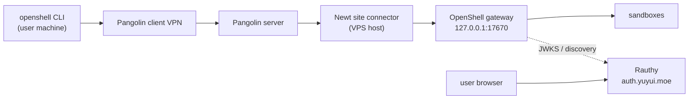

# OpenShell over Pangolin (private VPN)

Run a shared NVIDIA **OpenShell** gateway on a Debian VPS, reachable only through
**Pangolin**'s zero-trust VPN, with **Rauthy** as the OIDC identity provider. One
Rauthy account signs you into both Pangolin and OpenShell.

This is the primary recipe for Secure AI Homelab. The [VibePod Homelab](#previous-approach-vibepod-homelab)
pages describe the earlier single-host approach.

## What this gives you

- Each person runs `openshell` on their own machine and reaches the gateway over
  the Pangolin VPN. Nothing is published on the public internet except the IdP.
- The gateway authenticates users with **OIDC** (Rauthy) and keeps **mTLS** as a
  break-glass path if the IdP is down.
- Agents run in OpenShell sandboxes: deny-by-default network, Landlock
  filesystem policy, and credentials held by the gateway, never in the sandbox.

## Topology



Two authentication layers protect the gateway:

| Layer | Question it answers | Where it is set |
|---|---|---|
| Pangolin private resource | Which user or device may open a tunnel | Pangolin roles/users |
| OpenShell OIDC / mTLS | Which identity may drive the gateway | Rauthy + gateway |

The gateway holds your Podman socket, so gateway access is equivalent to running
containers as your VPS user. Keep it private.

## Placeholders

Replace these throughout:

| Placeholder | Value used here | Meaning |
|---|---|---|
| `<alias>` | `ai-sbx.yuyui.moe` | Pangolin alias for the gateway |
| `<idp>` | `auth.yuyui.moe` | Public hostname of Rauthy |
| `<vps>` | your Debian VPS | Host running Newt + the gateway |

## Prerequisites

- Debian 13 (trixie) VPS, rootless Podman, and the OpenShell package installed:

  ```bash
  openshell --version
  openshell gateway list
  systemctl --user status openshell-gateway
  ```

- The kernel preflight passes. From this repo:

  ```bash
  ./scripts/check-openshell-host.sh --probe --container
  ```

- Pangolin with a **host-level Newt** site connector (`systemctl status newt`),
  and DNS for `<idp>` and `<alias>` under your domain.
- Your gateway is the loopback package install (`https://127.0.0.1:17670`). The
  paths below match Debian/RPM installs.

!!! warning "Set the SAN first"
    Adding a Subject Alternative Name changes the gateway's required SAN set, and
    `openshell-gateway` **regenerates the whole local PKI** (new CA, new server and
    client certificates) when that happens. Existing mTLS bundles stop working.
    Do [Part 2](#part-2-gateway-oidc-and-san) once, before you hand out any
    client certificates.

## Part 1 — Rauthy identity provider

Rauthy is a single ~40 MB Rust container with an embedded database. It must be
**publicly reachable over HTTPS** so the gateway can fetch its discovery document
and JWKS, and so each user's browser can reach the login page. The OpenShell
gateway itself stays private.

### 1.1 Secrets

`scripts/install-rauthy.sh` generates the encryption key, the active key id and
the two Hiqlite secrets when it writes the env file. To do it by hand:

```bash
key_id=$(openssl rand -hex 4); key=$(openssl rand -base64 32)
printf 'ENC_KEYS=%s/%s\nENC_KEY_ACTIVE=%s\n' "$key_id" "$key" "$key_id"
printf 'HQL_SECRET_RAFT=%s\n' "$(openssl rand -base64 48)"
printf 'HQL_SECRET_API=%s\n'  "$(openssl rand -base64 48)"
```

Rauthy refuses to start without **both** `ENC_KEYS` and `ENC_KEY_ACTIVE`.

### 1.2 Deploy Rauthy (quadlets)

Rauthy runs as a rootless Podman quadlet, like the rest of this repo — no compose.
On the VPS checkout:

```bash
./scripts/install-rauthy.sh auth.yuyui.moe    # copies quadlets, generates secrets
$EDITOR ~/.config/secure-ai-homelab/rauthy.env   # set BOOTSTRAP_ADMIN_EMAIL
systemctl --user start rauthy.service
podman logs -f rauthy        # copy the generated admin password (shown once)
```

Passing the domain fills `PUB_URL`, `RP_ID` and `RP_ORIGIN`. Three values are
easy to get wrong:

- `PUB_URL` is the authority **only** — `auth.yuyui.moe`, never `https://auth.yuyui.moe`.
  Rauthy derives the scheme from `LISTEN_SCHEME` + `PROXY_MODE` (and with
  `PROXY_MODE=true` it builds `https`).
- `RP_ID` is the bare domain (`auth.yuyui.moe`) and `RP_ORIGIN` **must include a port**
  (`https://auth.yuyui.moe:443`). Rauthy refuses to start without them.
- `ENC_KEYS` and `ENC_KEY_ACTIVE` are both required; the installer generates both.

!!! note "Quadlets cannot be enabled"
    Do not run `systemctl --user enable rauthy.service`. The unit is generated
    under `/run/user/<uid>/systemd/generator/`, and systemd rejects enabling a
    generated unit. The quadlet's `[Install] WantedBy=default.target` makes the
    generator enable it at `daemon-reload`, so `start` is all you need.

The unit (`deploy/rauthy/rauthy.container`) runs Rauthy on plain HTTP port `8080`,
bound to loopback, with `proxy_mode = true`. Rauthy's own TLS stays off because
Pangolin terminates TLS at `https://<idp>`. The embedded database and generated
signing keys live in the `rauthy-data` volume.

### 1.3 Expose Rauthy through Pangolin

Add a **public HTTP resource** for `<idp>` targeting `localhost:8080` on the Newt
site. Do **not** attach a Pangolin SSO policy to it — Rauthy is the identity
provider; a login gate in front of it creates a redirect loop.

Verify from anywhere (note the `/auth/v1/` path — Rauthy scopes its issuer to it):

```bash
curl -s https://<idp>/auth/v1/.well-known/openid-configuration | head
```

Rauthy's endpoints, which you need below:

| Value | URL |
|---|---|
| Issuer | `https://<idp>/auth/v1/` |
| Authorization | `https://<idp>/auth/v1/oidc/authorize` |
| Token | `https://<idp>/auth/v1/oidc/token` |
| JWKS | `https://<idp>/auth/v1/oidc/certs` |

!!! note "No Pangolin? Terminate TLS with Caddy"
    A local VM or a host without Pangolin still needs HTTPS in front of Rauthy,
    or the gateway cannot fetch discovery/JWKS. `scripts/install-caddy.sh` runs
    Caddy as a rootless quadlet with its own internal CA:

    ```bash
    ./scripts/install-rauthy.sh auth.example.test 8443   # note the port
    ./scripts/install-caddy.sh auth.example.test 8443
    echo '127.0.0.1 auth.example.test' | sudo tee -a /etc/hosts
    curl -s https://auth.example.test:8443/auth/v1/.well-known/openid-configuration | head
    ```

    Caddy reverse-proxies everything (the `/auth/v1/` prefix preserved) to Rauthy
    on `127.0.0.1:8080`, and the installer adds Caddy's internal root CA to the
    host trust store so the gateway trusts the self-signed leaf.

    Port `8443`, not `443`: rootless Podman cannot bind a port below
    `net.ipv4.ip_unprivileged_port_start` (1024), and Caddy disables its
    HTTP->HTTPS `:80` listener for the same reason. If you want 443 on a
    rehearsal host, set `net.ipv4.ip_unprivileged_port_start=0` (root) and pass
    `443` to both scripts.

### 1.4 Create the roles, groups and users

In the Rauthy admin UI (`https://<idp>/admin`):

1. **Roles** — create `openshell-admin` (you) and `openshell-user` (everyone
   else). These land in the access token's `roles` claim, which OpenShell reads.
2. **Add your user** and assign `rauthy_admin` **and** `openshell-admin`. Do not
   reuse the default `admin@localhost` account.
3. Add each other person and assign `openshell-user`.
4. Optionally create a group (for example `openshell`) so the OIDC client can be
   restricted to it.

### 1.5 Create the OpenShell OIDC client

Still in the admin UI, under **Clients**, create a client:

| Field | Value |
|---|---|
| Client id | `openshell-cli` |
| Confidential | No (public client, PKCE) |
| Redirect URIs | `http://127.0.0.1/callback` |
| Scopes | `openid profile email` |

!!! note "Why there is no port"
    The OpenShell CLI binds an **ephemeral** loopback port on every login
    (`TcpListener::bind("127.0.0.1:0")`), so the redirect is
    `http://127.0.0.1:<random>/callback`. Register the **port-less** form and keep
    `RFC_8252_ENABLE=true` in `rauthy.env` (the installer sets it): Rauthy then
    matches a loopback redirect on any port (RFC 8252 §7.3).

    Do **not** use `http://127.0.0.1:*/callback` — Rauthy parses the redirect as a
    real URL and rejects the `*` with "Invalid URI". I verified both directions on
    Rauthy 0.37.1: `RFC_8252_ENABLE=true` accepts an ephemeral port, and `false`
    returns `400 Invalid redirect uri`.

The client id `openshell-cli` is deliberate: Rauthy sets the access token
audience to the client id, which matches OpenShell's default audience.

!!! note "There is no `roles` scope"
    Rauthy always puts the user's roles in the access token's `roles` claim; it is
    not gated by a scope. (`groups` is different — it needs the `groups` scope.)
    An unknown scope such as `roles` is silently ignored, so leave it out and keep
    `OPENSHELL_OIDC_ROLES_CLAIM=roles` on the gateway.

### 1.6 Sign in to Pangolin with Rauthy (optional)

Pangolin can use the same Rauthy instance as its identity provider. **Pangolin
generates the redirect URL**, so the order matters:

1. In Rauthy, create a client for Pangolin (confidential). Leave the redirect URI
   empty if Rauthy lets you; otherwise put a temporary placeholder and fix it in
   step 4. Note the client id and secret.
2. In Pangolin, add an **OAuth2/OIDC** identity provider with the fields below.
3. Create it, open the provider's **General** tab, and copy its **Redirect URL**.
4. Put that Redirect URL into the Rauthy client's `redirect_uris` and save.

| Pangolin field | Value |
|---|---|
| Client ID / Secret | from the Rauthy client |
| Authorization URL | `https://<idp>/auth/v1/oidc/authorize` |
| Token URL | `https://<idp>/auth/v1/oidc/token` |
| Identifier path | `sub` |
| Email path | `email` |
| Name path | `preferred_username` |
| Scopes | `openid profile email` |

**Post Logout Redirect:** Pangolin's documentation defines only the Redirect URL;
it does not document a post-logout URL for the OIDC provider. Rauthy's `Post
Logout Redirect URIs` field is optional, so leave it empty unless your provider's
General tab shows a logout URL to use.

Reference (Pangolin):

- [OAuth2/OIDC identity provider](https://docs.pangolin.net/manage/identity-providers/openid-connect)
- [Add Identity Providers](https://docs.pangolin.net/manage/identity-providers/add-an-idp)
- [Zitadel example](https://docs.pangolin.net/manage/identity-providers/zitadel) —
  documents the "copy the Redirect URL from the General tab" step

## Part 2 — Gateway OIDC and SAN

On the VPS, edit `~/.config/openshell/gateway.toml`.

### 2.1 Add the alias SAN

```toml
[openshell.gateway]
# Keep the package default listener and driver.
# NOTE: the key is `compute_driver` (singular). `compute_drive` or
# `compute_drivers` makes the gateway refuse the file as malformed.
server_sans = ["<alias>", "openshell", "*.dev.openshell.localhost", "127.0.0.1", "localhost"]

[openshell.gateway.oidc]
# Trailing slash is required: it is part of Rauthy's issuer identifier and of
# the discovery URL.
issuer           = "https://<idp>/auth/v1/"
audience         = "openshell-cli"
roles_claim      = "roles"
admin_role       = "openshell-admin"
user_role        = "openshell-user"
scopes_claim     = ""
# jwks_allowed_origins defaults to the issuer origin; leave it unset unless the
# IdP serves JWKS from another origin.
```

!!! warning "On the apt/systemd install, `server_sans` does not set the certificate"
    The Debian/RPM unit generates the PKI with
    `ExecStartPre=generate-certs --server-san host.openshell.internal`. In
    OpenShell 0.1.3 the `server_sans` field in `gateway.toml` is **not** consulted
    for the certificate, so adding it there has no effect. Override the pre-step
    with a drop-in and regenerate:

    ```ini
    # ~/.config/systemd/user/openshell-gateway.service.d/server-sans.conf
    [Service]
    ExecStartPre=
    ExecStartPre=/usr/bin/openshell-gateway config preflight
    ExecStartPre=/usr/bin/openshell-gateway generate-certs --output-dir ${OPENSHELL_LOCAL_TLS_DIR} --server-san host.openshell.internal --server-san <alias> --server-san <endpoint-host>
    ```

    ```bash
    systemctl --user daemon-reload
    rm -rf ~/.local/state/openshell/tls   # the WHOLE dir; a leftover jwt/ => "partial PKI state"
    systemctl --user restart openshell-gateway
    openssl x509 -in ~/.local/state/openshell/tls/server/tls.crt -noout -ext subjectAltName
    ```

    Regenerating replaces the CA and the client certificates, so every client
    must re-trust the new CA (Part 4.2) and any old mTLS bundle is dead (Part 5).

!!! note "Role names must match exactly"
    `admin_role` / `user_role` (and the Rauthy roles they name) must be
    `openshell-admin` / `openshell-user`, with hyphens. An mTLS client is always
    assigned the hardcoded `openshell-user`, so a config that expects
    `openshell_user` leaves the break-glass certificate unauthorized with
    `role 'openshell_user' required`, even though `openshell whoami` shows
    `Roles: openshell-user`.

### 2.2 Keep mTLS as break-glass

With an OIDC issuer configured, mTLS user authentication defaults **off**. Force
it back on so your client certificate still works when Rauthy is down. Write
`~/.config/openshell/gateway.env` (OpenShell 0.1.3):

```bash
OPENSHELL_ENABLE_MTLS_AUTH=true
OPENSHELL_TLS_CERT=/home/<you>/.local/state/openshell/tls/server/tls.crt
OPENSHELL_TLS_KEY=/home/<you>/.local/state/openshell/tls/server/tls.key
OPENSHELL_TLS_CLIENT_CA=/home/<you>/.local/state/openshell/tls/ca.crt
```

Paths are literal: the package unit loads this file as a systemd
`EnvironmentFile=`, which does **not** expand `~` or `$HOME`.

!!! warning "`OPENSHELL_ENABLE_MTLS_AUTH=true` alone fails preflight"
    mTLS user auth requires a client CA **and** the listener cert/key in the same
    effective config. With only the boolean set, `config preflight` rejects the
    file as `category=malformed detected_version=2` — the category is misleading,
    the real cause is the missing `--tls-client-ca`. The three paths above point
    at the PKI `generate-certs` already wrote under `OPENSHELL_LOCAL_TLS_DIR`
    (default `~/.local/state/openshell/tls`). The file form has the same
    requirement: `[openshell.gateway.mtls_auth] enabled = true` is invalid
    unless `[openshell.gateway.tls]` also sets `cert_path`, `key_path` and
    `client_ca_path`.

### 2.3 Restart and verify

```bash
# Validate the file before restarting; the systemd unit runs the same check.
openshell-gateway config preflight --path ~/.config/openshell/gateway.toml

systemctl --user restart openshell-gateway
journalctl --user -u openshell-gateway -n 50 --no-pager
openshell gateway list
openshell status
```

Because the SAN set changed, `~/.local/state/openshell/tls/` is regenerated (new
CA, new server and client certificates). Any machine that already had the old
mTLS bundle must be re-enrolled (Part 5), and OIDC clients must re-trust the new
CA (Part 4.2). The gateway host's own `local` registration caches the CA under
`~/.config/openshell/gateways/local/mtls/`, so refresh it too or it fails with
`invalid peer certificate: BadSignature`.

!!! note "The first identity needs workspace membership"
    A freshly authenticated principal is not a member of the `default`
    workspace, and every `openshell sandbox ...` / `provider ...` call fails with
    *"not a member of workspace 'default'"*. An OIDC user holding
    `openshell-admin` can grant membership in the admin UI or CLI. On a headless
    host with no browser OIDC login, bootstrap the mTLS principal once: remove
    the `[openshell.gateway.oidc]` table, restart the gateway (mTLS is then the
    only identity), grant the membership, then put the table back and restart.

    ```bash
    openshell workspace member add --workspace default \
      --subject openshell-client --role admin
    ```

## Part 3 — Pangolin private resource

Create a **Host** private resource:

| Field | Value |
|---|---|
| Destination | `127.0.0.1` (loopback on the site host) |
| Alias | `<alias>` (required for loopback destinations) |
| Port restriction | `17670` |
| Access | Grant to the `openshell` group or named users |

Then, on each user's machine, connect the Pangolin client and confirm the
gateway answers over the tunnel:

```bash
# after `pangolin` client is connected
openssl s_client -connect <alias>:17670 -servername <alias> </dev/null 2>/dev/null | head -1
```

A TLS line means the tunnel and the certificate SAN are both correct.

!!! warning "Newt and loopback"
    `127.0.0.1` means the connector's loopback. Newt runs at host level here, so
    it reaches the gateway directly. If you ever move Newt into a bridge-networked
    container, point the destination at an address Newt can reach instead.

## Part 4 — Clients

### 4.1 Install the OpenShell CLI

=== "Linux / macOS"

    ```bash
    curl -LsSf https://raw.githubusercontent.com/NVIDIA/OpenShell/main/install.sh | sh
    openshell --version
    ```

=== "Windows"

    Install from the OpenShell release assets, then run the same commands from
    PowerShell. Use the path where the installer placed `openshell.exe`.

### 4.2 Register the gateway

With the Pangolin client connected:

```bash
openshell gateway add https://<alias>:17670 \
  --name homelab \
  --oidc-issuer https://<idp>/auth/v1/ \
  --oidc-client-id openshell-cli \
  --oidc-audience openshell-cli \
  --oidc-scopes "openid profile email"
```

A browser opens, you log in to Rauthy, and the CLI stores the token bundle. Then:

```bash
openshell whoami
openshell sandbox create --name smoke -- echo alive!
openshell sandbox delete smoke
```

!!! warning "The CLI does not trust the gateway's self-signed CA"
    For an **OIDC** gateway the CLI verifies the server with the *system* trust
    store (it reads `SSL_CERT_FILE` / `SSL_CERT_DIR`); a per-gateway
    `~/.config/openshell/gateways/<name>/mtls/ca.crt` is only used for mTLS
    registrations. `gateway add` reports "Authenticated successfully" because the
    token exchange is with the IdP — the first gateway call (`whoami`) then fails
    with `invalid peer certificate: UnknownIssuer`.

    Copy the gateway's `~/.local/state/openshell/tls/ca.crt` to each client and
    trust it (pick your distro's tool):

    ```bash
    # Debian / Ubuntu
    sudo cp openshell-ca.crt /usr/local/share/ca-certificates/openshell-gateway.crt
    sudo update-ca-certificates

    # Arch Linux (p11-kit): no update-ca-certificates; drop an anchor and rebuild
    sudo install -m 0644 openshell-ca.crt /etc/ca-certificates/trust-source/anchors/openshell-gateway.crt
    sudo update-ca-trust
    # equivalent: sudo trust anchor --store openshell-ca.crt && sudo update-ca-trust

    # Fedora / RHEL
    sudo cp openshell-ca.crt /etc/pki/ca-trust/source/anchors/openshell-gateway.crt
    sudo update-ca-trust
    ```

    Without root, point the CLI at a bundle that also contains the system CAs
    (`SSL_CERT_FILE` *replaces* the bundle, it does not add to it):

    ```bash
    cat /etc/ssl/certs/ca-certificates.crt openshell-ca.crt > ~/.config/openshell/ca-bundle.crt
    export SSL_CERT_FILE=~/.config/openshell/ca-bundle.crt   # scope to the shell
    ```

    A certificate that is trusted but missing the endpoint name fails
    differently (`certificate is valid for ...`); both fixes are needed — the
    name goes in the server's SAN set (Part 2.1), the CA on every client.

## Part 5 — Break-glass mTLS certificates

OIDC is the daily path. If Rauthy is unreachable, a client certificate still gets
you in. Mint one certificate per person from the gateway's local CA:

```bash
./scripts/openshell-user-cert.sh mint alice
./scripts/openshell-user-cert.sh list
```

The script writes `alice.crt` / `alice.key` (chmod 600) next to the CA. Send the
person their key over a secure channel, and have them place it in:

```text
~/.config/openshell/gateways/homelab-mtls/mtls/
  ca.crt
  tls.crt   # alice.crt
  tls.key   # alice.key
```

Then register the mTLS gateway as a fallback:

```bash
openshell gateway add https://<alias>:17670 --name homelab-mtls
```

Revoke by deleting the person's certificate in Rauthy **and** regenerating the
local PKI, or by minting short-lived certificates. Track serial numbers with
`openshell-user-cert.sh list`.

## Part 6 — Long-term memory (ai-memory)

One ai-memory instance serves every sandbox. Memory is scoped per actor
(`auto_scope = per_actor`) and attributed, so a person's agents cannot read or
overwrite another person's active project. Pages in the *same project* are
shared with teammates by design; personal handoffs stay personal.

### 6.1 Deploy ai-memory on the gateway host

```bash
./scripts/install-ai-memory.sh
systemctl --user start ai-memory.service
curl -s -o /dev/null -w '%{http_code}\n' http://127.0.0.1:49374/mcp   # 401 = auth on
```

The server binds host loopback. The OpenShell supervisor is host-networked and
reaches it through the `host.openshell.internal` alias (which maps to
`host_gateway_ip`, `127.0.0.1` on native Linux).

!!! note "Image base"
    The ai-memory image is Debian-based (`debian:bookworm-slim`), which runs on
    baseline x86-64 — including hosts whose CPU lacks x86-64-v2, where a Wolfi
    base dies with `Fatal glibc error: CPU does not support x86-64-v2`. To skip
    the local build, `--no-build` uses a prebuilt image:

    ```bash
    podman pull docker.io/akitaonrails/ai-memory:latest
    podman tag  docker.io/akitaonrails/ai-memory:latest localhost/secure-ai-homelab/ai-memory:latest
    ./scripts/install-ai-memory.sh --no-build
    ```

### 6.2 Give each person a key

```bash
./scripts/ai-memory-user.sh add alice
./scripts/ai-memory-user.sh key alice      # prints an aim_... token, shown once
```

### 6.3 Authorize sandboxes

```bash
openshell profile import -f deploy/ai-memory/provider-profile.yaml
openshell provider create --name ai-memory-alice --type ai-memory \
  --credential AI_MEMORY_AUTH_TOKEN=aim_...
openshell sandbox create --name mem --from <agent-image> \
  --provider ai-memory-alice -- <agent>
```

`--credential` takes the **environment variable name** (`AI_MEMORY_AUTH_TOKEN`),
not the profile's credential name — passing the latter fails with *"provider
credentials are not declared by profile"*. The sandbox sees only an opaque
placeholder; the supervisor substitutes the real key only for requests to
`host.openshell.internal:49374`.

Scope the profile's `binaries` list to the real agent/MCP client before use.
The shipped profile lists `/usr/bin/curl` for the smoke test and
`/usr/local/bin/node` for Pi (its ai-memory bridge runs inside the node process);
without the node entry the supervisor blocks the request and the client sees a
failed fetch.

### 6.4 The Pi workload image

Build the Pi workload image from this repo (it bakes Pi's ai-memory bridge in):

```bash
podman build \
  --build-arg AI_MEMORY_CLI_IMAGE=localhost/secure-ai-homelab/ai-memory:latest \
  -t localhost/secure-ai-homelab/pi:latest \
  -f docker/pi/Containerfile docker/pi
```

Then create a sandbox from it with the person's provider:

```bash
openshell sandbox create --name pi-mem \
  --from localhost/secure-ai-homelab/pi:latest \
  --provider ai-memory-alice -- pi
```

The image bakes Pi's bridge extension (`ai-memory install-hooks --agent pi`),
which reads `AI_MEMORY_AUTH_TOKEN` from the environment at run time, so what the
sandbox holds is the provider's opaque placeholder and the supervisor substitutes
the real key at the endpoint. Claude Code and ZCode are installed alongside Pi.

!!! warning "CPU compatibility: hosts without SSE4.2"
    The image is **Debian + Node**, not Wolfi and not pi-bolt, because the target
    CPU is x86-64 baseline (no SSE4.2):

    | Component | Result | Why |
    |---|---|---|
    | Wolfi base | fails | glibc built for x86-64-v2: `Fatal glibc error: CPU does not support x86-64-v2` |
    | pi-bolt | fails | AOT binary requires SSE4.2, `x64-baseline` included: *"Pi-Bolt needs a CPU with SSE4.2"* |
    | `@earendil-works/pi-coding-agent` (Node) | runs | pure JavaScript |
    | Claude Code 2.1.113+ | hangs | native binary spins at 100% CPU; the image pins **2.1.112**, the last pure-JS release |
    | ZCode (`zcode-app-cli`) | runs | Node-based |
    | Bun global installs | hang | `bun add -g` spins at 100% CPU; the image uses `npm` throughout |

    OpenShell also rejects a workload image whose declared user is root
    (*"workload identity must not contain UID or GID zero"*), so the image ends
    with `USER 1000:1000` and its entrypoint is a no-op when it is already
    non-root.

## Troubleshooting

| Symptom | Cause | Fix |
|---|---|---|
| `x509: certificate is valid for ...` on connect | Endpoint name missing from the server certificate | Add it via `generate-certs --server-san` (Part 2.1), regenerate, re-enroll bundles |
| `invalid peer certificate: UnknownIssuer` | CLI does not trust the gateway's self-signed CA | Trust `~/.local/state/openshell/tls/ca.crt` on the client (system store or `SSL_CERT_FILE`, Part 4.2) |
| `invalid peer certificate: BadSignature` after a SAN change | Cached old CA in `~/.config/openshell/gateways/<name>/mtls/` | Refresh `ca.crt`/`tls.crt`/`tls.key` from `~/.local/state/openshell/tls/` (Part 2.3) |
| `partial PKI state in ...: some files exist but not all` | Only part of `~/.local/state/openshell/tls` was removed | `rm -rf` the whole `tls` dir (it includes `jwt/`) and restart |
| `role 'openshell_user' required` with an mTLS client | Config roles use underscores, but mTLS is hardcoded to `openshell-user` | Use `openshell-admin`/`openshell-user` in Rauthy and the gateway config (Part 2.1) |
| Login redirect fails | Redirect URI not registered | Register `http://127.0.0.1/callback` (port-less) with `RFC_8252_ENABLE=true` |
| `Authentication: Failed` / browser opens but no roles | Roles claim empty | Confirm `roles_claim = "roles"` and that the user has `openshell-admin` or `openshell-user` |
| Gateway cannot reach the IdP | Issuer not HTTPS or not reachable from the VPS | `curl https://<idp>/auth/v1/.well-known/openid-configuration` from the VPS |
| Everyone loses access after a SAN change | Local PKI regenerated (new CA) | Re-copy the new client bundle / re-run `gateway add`, and re-trust the CA (Part 4.2) |
| Tunnel connects, nothing answers | Newt cannot reach the gateway | Check `systemctl status newt` and that the resource targets port `17670` |
| `gateway config preflight failed: category=malformed` | Bad key or value in `gateway.toml` | Run `openshell-gateway config preflight --path ~/.config/openshell/gateway.toml`; check for `compute_drive` (needs `compute_driver`) |
| Login fails with an issuer mismatch | `issuer` missing its trailing slash | Use `https://<idp>/auth/v1/` exactly |
| Sandbox stuck in `Error`; reason mentions `getent`/`passwd database` | The gateway auto-selected the **Docker** driver (Podman socket down, Docker present) | Pin `compute_driver = "podman"` in `gateway.toml` and `systemctl --user enable --now podman.socket` |
| `provider credentials are not declared by profile` | `--credential` used the credential name | Use the env var name, e.g. `--credential AI_MEMORY_AUTH_TOKEN=…` |
| `Fatal glibc error: CPU does not support x86-64-v2` | A Wolfi-based image on a CPU without v2 | Use a Debian-based image; the Pi workload image and ai-memory both are |
| `Pi-Bolt needs a CPU with SSE4.2` | pi-bolt on an x86-64-baseline CPU | Use the standard Pi agent (the Pi workload image does) |
| Claude Code hangs at 100% CPU | Native Claude Code 2.1.113+ on a CPU without SSE4.2 | Pin `@anthropic-ai/claude-code@2.1.112` (last pure-JS release) |
| `workload identity must not contain UID or GID zero` | Workload image's `USER` is root | End the image with `USER 1000:1000` |
| `not a member of workspace 'default'` | Identity has no workspace membership | `openshell workspace member add --workspace default --subject <sub> --role admin` (see Part 2.3) |
| Preflight `category=malformed` with `OPENSHELL_ENABLE_MTLS_AUTH=true` | mTLS needs a client CA + listener cert/key | Also set `OPENSHELL_TLS_CERT` / `OPENSHELL_TLS_KEY` / `OPENSHELL_TLS_CLIENT_CA` (Part 2.2) |
| ai-memory fails at start: `no recoverable root user` or `refusing human authentication on non-loopback` | The token pepper enables human/session auth | Set `AI_MEMORY_AUTH__RECOVERY_TOKEN` (>=32 chars) and `AI_MEMORY_AUTH__SECURE_COOKIE=true` |

## Security notes

- The gateway holds the container runtime socket. Never expose it beyond the
  Pangolin VPN, and never disable OpenShell authentication.
- The IdP is public by design; the gateway is not. Keep `<alias>` resolvable only
  through Pangolin.
- Prefer per-user certificates or OIDC. A shared client bundle has no revocable
  identity.
- Pin the Rauthy image tag (`deploy/rauthy/rauthy.container`) and review updates.
- See [Security](../concepts/security.md) for the general model.

## Previous approach: VibePod Homelab

The VibePod pages below describe the earlier design: a single rootless Podman pod
with Podman-in-Podman, a shared credential store and a shared workspace volume. It
is appropriate for **one trusted operator**. It is not multi-tenant, so it is kept
here for reference rather than as the recommended path.

- [Architecture](../concepts/architecture.md)
- [Deployment](../reference/deployment.md)
