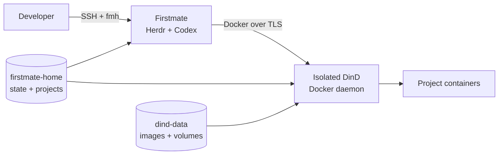

<div align="center" markdown>


# Firstmate Homelab

Self-hosted development environment for **Firstmate + Herdr + Codex CLI**.

Keep the agent runtime, Git worktrees, GitHub credentials and project Docker workloads on your homelab, while giving agents an isolated Docker development environment.

[Get started](getting-started/installation.md){ .md-button .md-button--primary }
[CLI reference](reference/cli.md){ .md-button }

</div>

## How it fits together



The important boundary is simple: agents get a real Docker development environment, but they **do not receive the physical homelab Docker socket**. Docker commands from Firstmate target a dedicated Docker-in-Docker daemon.

## Explore the documentation

- [Installation](getting-started/installation.md) — install and bootstrap the stack.
- [Docker development](guides/docker-development.md) — project containers, networking and bind mounts.
- [Developer shell](guides/developer-shell.md) — Fish and the included terminal tooling.
- [CLI reference](reference/cli.md) — all `fmh` commands and lifecycle operations.
- [Architecture](concepts/architecture.md) — runtime, persistence and isolation model.
- [Security](concepts/security.md) — trust boundary and DinD limitations.

## Typical workflow

```bash
ssh homelab
fmh connect
```

Or open the developer shell directly:

```bash
fmh shell
```

Inside Firstmate, Docker behaves like a normal development workstation:

```bash
docker version
docker build .
docker compose up --build
```

Those commands target the isolated DinD daemon, not the Docker daemon that manages the rest of the homelab.
