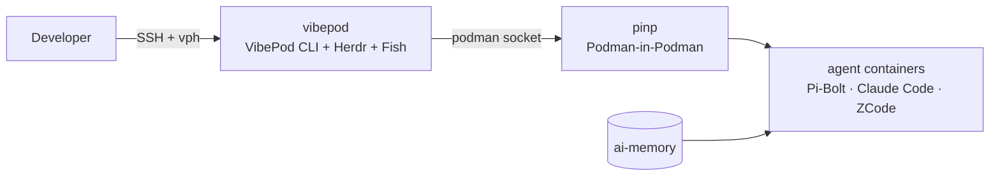

<div align="center" markdown>


# VibePod Homelab

Self-hosted **VibePod** agent platform running **Pi-Bolt**, **Claude Code** and **ZCode** in a rootless Podman-in-Podman pod.

[Get started](getting-started/installation.md){ .md-button .md-button--primary }
[Architecture](concepts/architecture.md){ .md-button }
[Deployment](reference/deployment.md){ .md-button }

</div>

## How it fits together



The boundary is simple: agents get a real container runtime, but **not the host Podman/Docker socket**. VibePod (`vp`) manages the agents; the inner Podman (**PinP**) is the only runtime they can see.

## Explore the documentation

- [Installation](getting-started/installation.md) — deploy the rootless quadlets and bootstrap.
- [Architecture](concepts/architecture.md) — pod topology, PinP, persistence, networking.
- [Security](concepts/security.md) — trust boundary and PinP limitations.
- [PinP development](guides/pinp-development.md) — building and running project containers.
- [Developer shell](guides/developer-shell.md) — Fish and the included tooling.
- [CLI reference](reference/cli.md) — every `vph` command.
- [Deployment](reference/deployment.md) — rootless prerequisites, subuid/subgid, pasta, ai-memory and board wiring.

## Typical workflow

```bash
ssh homelab
vph connect          # Herdr multiplexer
```

Inside a pane:

```bash
vp run pi            # Pi-Bolt — the default agent
```

Docker-style work inside an agent targets PinP, never the host runtime:

```bash
podman build .
podman run --rm ...
```
