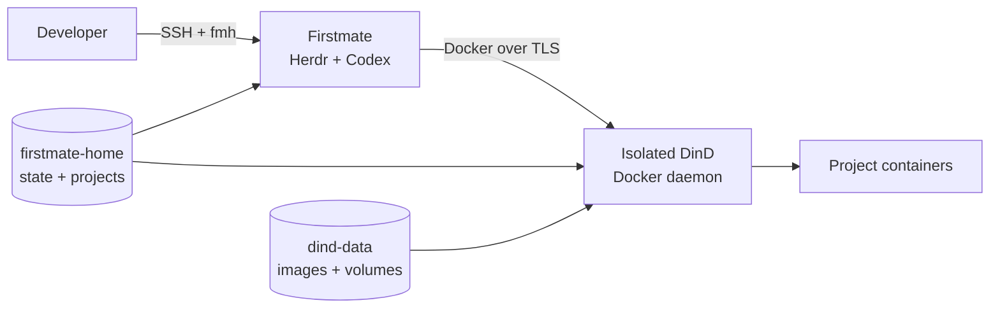

# Firstmate Homelab

Firstmate Homelab is a self-hosted development environment for **Firstmate + Herdr + Codex CLI**.

It keeps the agent runtime, Git worktrees, GitHub credentials and project Docker workloads on a homelab server while Codex authentication uses your ChatGPT account.



The important boundary is simple: agents get a real Docker development environment, but they **do not receive the physical homelab Docker socket**. Docker commands from Firstmate target a dedicated Docker-in-Docker daemon.

## Start here

If you are installing the stack for the first time, go to [Installation](getting-started/installation.md).

For day-to-day use:

- [CLI reference](reference/cli.md) lists the `fmh` commands;
- [Docker development](guides/docker-development.md) explains how project containers and bind mounts work;
- [Developer shell](guides/developer-shell.md) documents Fish and the included terminal tooling;
- [Architecture](concepts/architecture.md) explains the runtime and persistence model;
- [Security](concepts/security.md) documents the trust boundary and DinD limitations.

## Typical workflow

```bash
ssh homelab
fmh connect
```

Or open the developer shell directly:

```bash
fmh shell
```

Inside Firstmate, Docker behaves like a normal development workstation:

```bash
docker version
docker build .
docker compose up --build
```

Those commands target the isolated DinD daemon, not the Docker daemon that manages the rest of the homelab.
