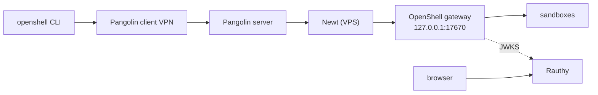

<div align="center" markdown>


# Secure AI Homelab

Recipes for self-hosting AI coding agents with real isolation — OpenShell behind
Pangolin's zero-trust VPN, with Rauthy as the OIDC identity provider.

[OpenShell + Pangolin recipe](guides/openshell-pangolin.md){ .md-button .md-button--primary }
[VibePod Homelab (previous)](getting-started/installation.md){ .md-button }

</div>

## Recommended: OpenShell over Pangolin



Each person reaches a shared OpenShell gateway through the Pangolin VPN. OpenShell
runs each agent in a kernel-enforced sandbox with deny-by-default network policy,
so a shared gateway stays safe even when agents are untrusted. Rauthy provides
the OIDC login, and one account signs into both Pangolin and OpenShell.

**Start here:** [OpenShell over Pangolin](guides/openshell-pangolin.md).

## Explore the documentation

- [OpenShell + Pangolin recipe](guides/openshell-pangolin.md) — the recommended, end-to-end path.
- [VibePod Homelab installation](getting-started/installation.md) — the previous single-operator stack.
- [VibePod architecture](concepts/architecture.md) — pod topology, PinP, persistence.
- [VibePod security](concepts/security.md) — its trust boundary and limitations.
- [Deployment reference](reference/deployment.md) — rootless prerequisites and quadlets.

## Verify the host

OpenShell needs Linux 6.2+, Landlock, and nested seccomp user notifications.
Check before deploying:

```bash
./scripts/check-openshell-host.sh --probe --container
```

## Previous approach: VibePod Homelab

VibePod Homelab keeps the agent runner, credentials, memory and project
workspaces in one rootless Podman-in-Podman pod. It is a single trust domain,
suitable for one operator. Its pages are kept for reference and are marked
"previous approach".
